# Лаба 4 — SLA критического пути под перегрузкой

Задание: https://github.com/KeladKaal/containerization-and-orchestration/blob/main-rus/lecture-4-scheduling-resources/lab.md

## Предисловие

В этот раз задача — не просто поднять `shop`, а заставить кластер **выбирать**, кем пожертвовать. Есть критический путь (оформление заказа `api → postgres`) и фоновая "ночная аналитика" `batch`, которая просто жрёт CPU и память. Когда ресурсов не хватает, страдать должна аналитика, а заказы — продолжать создаваться быстрее 300 мс.

Нужна была "намеренно тесная площадка, чтобы легко получить нехватку ресурсов". Яндекс Облако позаботилось об этом заранее: перед лабой мне урезали квоты, и ВМ ужалась до 2 vCPU / 8 GB. Тесноту выдали бесплатно и без возможности отказаться. Спасибо, сэкономили мне время 😄

Я смирился, поднял вторую ноду, дошёл до Части 3. Сделал перерыв, а когда хотел продолжить на следующий день ВМ отказалась стартовать.
Сначала облако отобрало у меня ресурсы, а потом и саму виртуалку. 
Оказалось, что это все было из-за беды с датацентрами Яндекса. Жалко их... Или нет...

Вот теперь и правда F за облачную виртуалку 🫡

Так что лаба доделана локально, в **WSL2** (Ubuntu 24.04) с docker-ce внутри и minikube на две ноды. Ноутбук, в отличие от облака, квоты не урезает. Хорошо, что чарт, код и заметки жили в репозитории: кластер пересобрал с нуля, заодно проверил, что чарт вообще ставиться с нуля без проблем.


## Часть 0 — Сервис batch

Код: [`./batch`](./batch)

Всё поведение задаётся через env, а значит через `values.yaml`:
- `CPU_WORKERS` горутин жгут CPU с долей занятости `CPU_DUTY` (окно 100 мс);
- `MEM_TARGET_MB` памяти набирается шагами `MEM_STEP_MB` раз в `MEM_STEP_INTERVAL` и держится. Каждая страница реально записывается, иначе ядро не выделит её физически и память не попадёт в working set;
- `/health` и `/metrics`: `batch_cpu_iterations_total` (его `rate` — "пропускная способность" batch, она должна деградировать первой), `batch_memory_held_bytes`, `batch_memory_target_bytes`.

Образ: `registry.local/shop/batch:0.1.0`.

## Часть 1 — Механизм разнесения

В [`values.yaml`](./chart/shop/values.yaml) появился блок `placement`:

```yaml
placement:
  mechanism: topologySpread
  topologyKey: kubernetes.io/hostname
  maxSkew: 1
  whenUnsatisfiable: DoNotSchedule
  antiAffinityMode: required
```

Шаблон — хелпер `shop.placement` в [`_helpers.tpl`](./chart/shop/templates/_helpers.tpl), подключён в `api-deployment.yaml`. При неизвестном значении `mechanism` чарт падает с ошибкой через `fail`, вместо создания пода без ограничений.

### Чем отличаются

| | `podAntiAffinity` | `topologySpreadConstraints` |
|---|---|---|
| Что проверяет | **есть ли** на ноде такой же под (0 или ≥1) | **перекос** числа подов между нодами (`maxSkew`) |
| 3 реплики на 2 нодах, `required` / `DoNotSchedule` | третья реплика `Pending`: на обеих нодах уже есть сосед | 2 + 1, перекос 1 ≤ `maxSkew` — всё встаёт |
| Масштабирование | жёсткий вариант = максимум реплик по числу нод | реплик сколько угодно, распределяются равномерно |
| Мягкий режим | `preferred` + вес | `ScheduleAnyway` |

### Что выбрал и почему

**`topologySpreadConstraints`** (maxSkew 1, `DoNotSchedule`). На двух нодах у меня 3 реплики `api`, и anti-affinity в жёстком режиме это просто не умеет.

Проверил на практике, переключив `mechanism: antiAffinity`:
- новый под `Pending` с `0/2 nodes are available: ... didn't match pod anti-affinity rules`;
- и вдобавок **deadlock rolling update**. Селектор (`name` + `instance`) цепляет и поды старой ReplicaSet. Обе ноды заняты старыми подами, `maxUnavailable: 0` не даёт убить старый под, пока не встанет новый, а новый не встанет, пока есть старый.
- в событиях было ещё `preemption: No preemption victims found` — у всех подов одинаковый приоритет, вытеснять некого. Это пригодилось в Части 6.

`preferred`-anti-affinity тоже бы встал, но он не гарантирует ничего: под давлением планировщик спокойно положит все реплики на одну ноду.

## Часть 2 — Тесная площадка и batch в чарте

Кластер: minikube, 2 ноды.

В чарт добавлены [`batch-deployment.yaml`](./chart/shop/templates/batch-deployment.yaml) и [`batch-service.yaml`](./chart/shop/templates/batch-service.yaml), ServiceMonitor теперь скрейпит `In [api, worker, batch]`. Гвардрейлы Лабы 3 работают: у `batch` есть `requests`, `limits.memory`, метки, образ из `registry.local/shop`, `nonroot`, явный тег.

Стартовые requests/limits — это моя **догадка** "на глаз", до каких-либо измерений:

| | cpu req | mem req | mem limit |
|---|---|---|---|
| api | 50m | 32Mi | 128Mi |
| worker | 25m | 32Mi | 128Mi |
| postgres | 100m | 256Mi | 512Mi |
| batch | 100m | 64Mi | 256Mi |

`batch` стартует мягко: 1 реплика, 1 горутина с `duty 0.5` (≈ 0,5 ядра), 64 MB памяти.

Ещё для лабы я заранее собрал дашборд [`dashboards/shop.json`](./chart/shop/dashboards/shop.json) на 4 блока: SLA (Часть 8), размещение и планирование (Части 4, 6), давление и вытеснение (Часть 7), ресурсы и гарантии (Части 3, 5).

## Часть 3 — Реальные числа вместо угадывания

### Нагрузка

```bash
IP=$(kubectl -n shop get svc shop-api -o jsonpath='{.spec.clusterIP}')
minikube ssh -- "hey -z 60m -c 20 -q 10 -disable-keepalive -m POST \
  -H 'Content-Type: application/json' -d '{\"item\":\"book\",\"qty\":1}' \
  http://$IP:8080/order"
```

`-disable-keepalive` нужен, иначе 20 соединений прилипают к подам неравномерно. Около 200 RPS.

### Первый прогон — отвергнут

Запустил нагрузку на 30 минут. Получил отчет krr, в котором были подозрительно маленькие цифры. Не поверив ему, поставил эти значения и снова запустил нагрузку, чтобы посмотреть как оно будет работать:

api` 20m CPU, `postgres` 50m CPU / 150Mi (requests = limits). Получил:
- `postgres` уперся в потолок: линия CPU ровно на 0,05 ядра, троттлинг 90–100%, сработал встроенный `CPUThrottlingHigh`
- `shop-db-1` **рестартовал** несколько раз. 

Мерить потребление под потолком бессмысленно. Поэтому я поставил специально повышенные лимиты и сделал второй прогон.

### Второй прогон — принят

60 минут, ≈ 196 RPS:

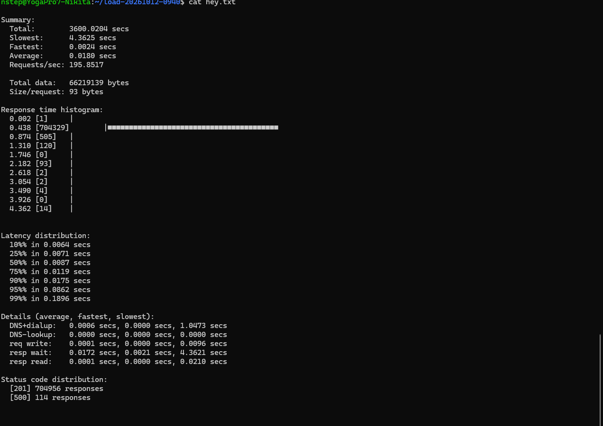

704 956 × `201`, 114 × `500` (0,016%), p95 **86 мс**, p99 **190 мс**.

Что происходило на дашборде за это время:

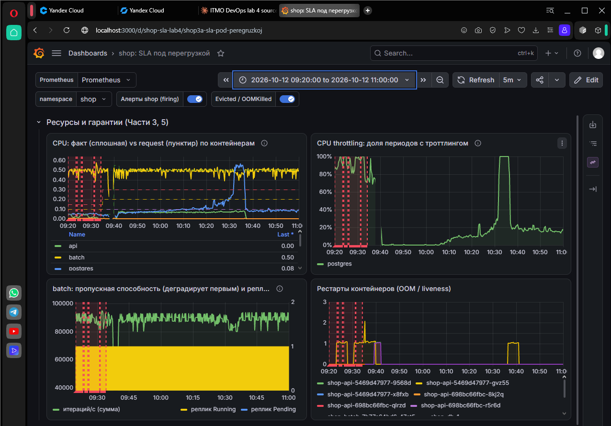

Слева до 09:40 — первый прогон (БД в потолке, рестарты). После — второй. 

### krr

```bash
krr simple -n shop -p http://localhost:9090 --history_duration 1.5 --timeframe_duration 0.25 --formatter table
```

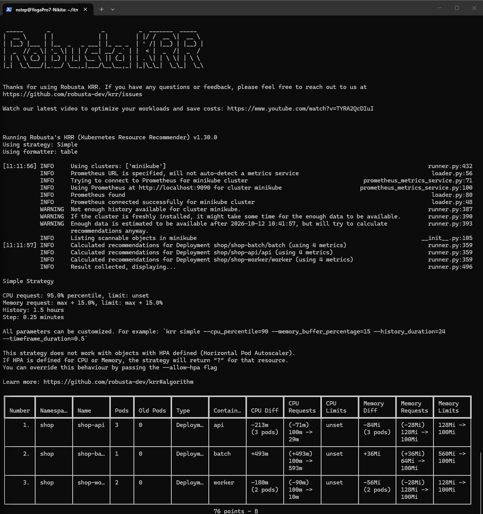

Полный вывод: [`krr-report.txt`](./krr-report.txt).

Что пришлось понять про krr по ходу:
- с шагом по умолчанию (1,25 мин) за час получается ~48 точек на под, и у `batch` (1 под) и `worker` (2 пода) было `?` — Not enough data. Шаг 15с решил проблему
- в первом запуске `Old Pods` у `api` = 3: в окно попали поды до `rollout restart` (те самые 100% `503`). Отчёт выше чистый — `Old Pods` = 0
- **krr не видит postgres**: поды БД принадлежат `Cluster` CNPG, а не Deployment/StatefulSet

### Догадка vs krr vs итог

| | догадка CPU | догадка mem req/limit | krr CPU | krr mem | **в values** |
|---|---|---|---|---|---|
| api | 50m | 32Mi / 128Mi | **29m** | 100Mi | **60m / 100Mi** (req = limit) |
| worker | 25m | 32Mi / 128Mi | 10m | 100Mi | 10m / 100Mi, limit только по памяти |
| postgres | 100m | 256Mi / 512Mi | — (не видит) | — | **1000m / 256Mi** (req = limit) |
| batch | 100m | 64Mi / 256Mi | **593m** | 100Mi | 100m → 500m / 64Mi, limit 560Mi |

Расхождения и откуда они:

- **Память `api`/`worker`: догадка 32Mi, krr 100Mi.** Реальный максимум в Prometheus — 23 Mi и 21 Mi. 100Mi — это, по всей видимости, нижний порог самого krr.
- **CPU `api`: догадка 50m, krr 29m, взял 60m.** krr рекомендует **request** (95-й перцентиль) и оставляет `CPU limit: unset`. Нам нужен был Guaranteed, поэтому, чтобы не упереться в троттлинг, взял запас на пиковое потребление **60m**.
- **postgres — вручную по алгоритму krr** (CPU — p95, память — max + 15%): p95 = 131m, max памяти 198 Mi → 228 Mi → **256Mi**. А вот CPU взял не 131m, а **1000m**: у Guaranteed число должно покрывать **пик**, а не p95. На графике CPU дошёл до 0,5 ядра и упёрся в калибровочный лимит 500m, т.е. реальная потребность ≥ 0,5, а p95 занижен самим потолком.
- **batch: догадка 100m, krr 593m.** batch реально жжёт ~0,6 ядра — ровно то, что я ему задал. Но числа krr ему не нужны: по заданию он Burstable с requests заметно ниже факта, это как раз и делает его жертвой.

Итоговые `resources` ([`values.yaml`](./chart/shop/values.yaml)):

```yaml
api:      requests: {cpu: 60m,   memory: 100Mi}  limits: {cpu: 60m,   memory: 100Mi}  # Guaranteed
database: requests: {cpu: 1000m, memory: 256Mi}  limits: {cpu: 1000m, memory: 256Mi}  # Guaranteed
worker:   requests: {cpu: 10m,   memory: 100Mi}  limits: {memory: 100Mi}              # Burstable
batch:    requests: {cpu: 500m,  memory: 64Mi}   limits: {memory: 560Mi}              # Burstable
```

## Часть 4 — Разнесение api

```bash
kubectl -n shop get pods -o custom-columns=NAME:.metadata.name,QOS:.status.qosClass,PRIO:.spec.priorityClassName,NODE:.spec.nodeName
```

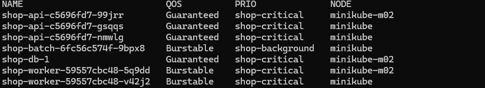

`shop-api` × 3: две реплики на `minikube`, одна на `minikube-m02`. По одному на ноду, БД на `m02`.

Как это повышает отказоустойчивость:
- падение **любой** ноды оставляет живыми минимум одну реплику `api` — сервис отвечает, пока поднимается замена
- то же самое при `drain` ноды: вместе с PDB выселение идёт по одному поду, и на второй ноде всегда есть кто-то живой
- запас CPU `api` (60m, ×1,5) как раз посчитан на то, что после отказа ноды трафик трёх реплик понесут две

Честно о пределах: на двух нодах `postgres` — единственный экземпляр (`instances: 1`), и при падении его ноды критический путь всё равно ляжет, пока БД не вернётся. Разнесение `api` защищает от падения "ноды с api", но не от падения "ноды с БД".

## Часть 5 — Приоритеты и гарантии

Новые шаблоны:
- [`priorityclass.yaml`](./chart/shop/templates/priorityclass.yaml) — цикл по `values.priority`;
- [`pdb.yaml`](./chart/shop/templates/pdb.yaml) — PDB для `api` и для primary БД.

```yaml
priority:
  critical:   {name: shop-critical,   value: 100000}   # api, postgres, worker
  background: {name: shop-background, value: -1000}    # batch
pdb:
  api:      {maxUnavailable: 1}
  database: {minAvailable: 1}
```

Результат на скриншоте Части 4: `api` × 3 и `shop-db-1` — **Guaranteed + shop-critical**, `worker` — **Burstable + shop-critical**, `batch` — **Burstable + shop-background**.

После `helm upgrade` с новыми лимитами троттлинг `postgres` (жёлтая линия) ушёл в ноль около 11:56, когда под БД перезапустился с 1000m:

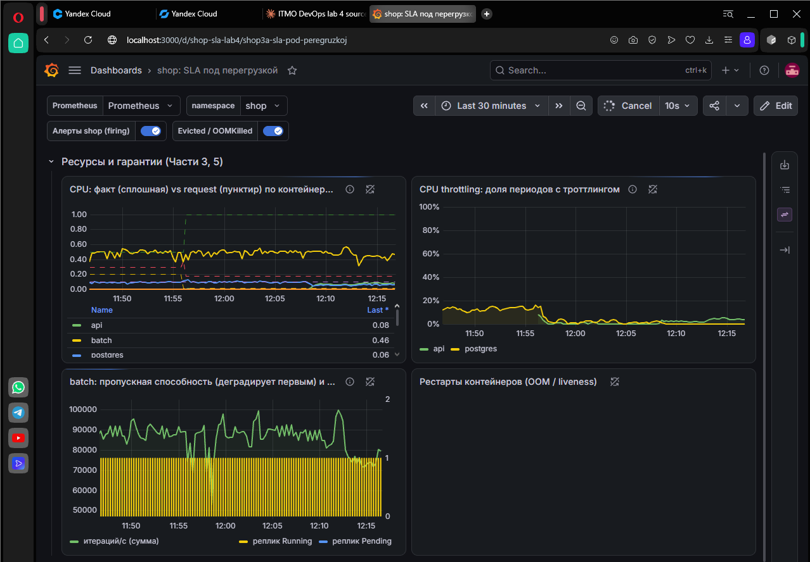

### Что каждая настройка даёт под давлением

| Настройка | Кто на неё смотрит | Что даёт |
|---|---|---|
| **requests** | планировщик | под встаёт только туда, где есть столько свободных requests. Под CPU-конкуренцией время делится пропорционально requests |
| **limits.memory** | ядро (cgroup) | превысил — `OOMKilled` этого контейнера, соседи не страдают |
| **limits.cpu** | ядро (CFS) | потолок: превысил квоту — троттлинг до конца периода 100 мс |
| **QoS-класс** (вычисляется из requests/limits) | kubelet | порядок жертв при eviction по памяти и `oom_score_adj` для ядерного OOM killer |
| **priorityClass** | планировщик и kubelet | preemption: под с высоким приоритетом выселяет низкоприоритетные, чтобы встать. При eviction — второй критерий после превышения requests |
| **PodDisruptionBudget** | Eviction API | ограничивает **добровольные** выселения: `drain`, автоскейлер нод, rollout через eviction |

### Burstable vs Guaranteed

- **Guaranteed**: `requests = limits` по CPU **и** памяти у всех контейнеров пода. Kubelet трогает их последними и только если под сам превысил requests или выселять больше некого.
- **Burstable**: requests есть, но меньше limits (или limits нет). Может потреблять больше гарантированного, но при давлении на ноду первым кандидатом становится тот, кто **сильнее всего превысил свои requests**.
- **BestEffort** — первые жертвы. В `shop` таких нет: Политики Kyverno бы их не пропустили

### Чем PDB защищает, а чем нет

- **Защищает** от добровольных выселений через Eviction API: `kubectl drain` не уберёт второй под `api`, пока первый не встанет на другой ноде. `drain` ноды с БД при `instances: 1` просто заблокируется — это лучше чем молча уронить базу
- **Не защищает** от node-pressure eviction (kubelet при нехватке памяти PDB не смотрит), падения ноды, `OOMKilled`, `kubectl delete pod`

### Что поймал

**Два PDB на один под БД.** CNPG по умолчанию создаёт свой PDB `shop-db-primary`, плюс мой `shop-db-primary-pdb`. При нескольких PDB на поде Eviction API отвечает ошибкой, и `drain` не пройдёт никогда. Выключил оператору `enablePDB: false`

## Часть 6 — Нехватка ресурсов, Pending и preemption

Всё это время в фоне работает `hey` (2 часа с 12:08, ~200 RPS) — это заодно данные для Части 8.

### batch растёт

Поднимаю `batch.replicas`: 1 → 5 → 10, и `requests.cpu` у batch до 500m, чтобы быстрее упереться.

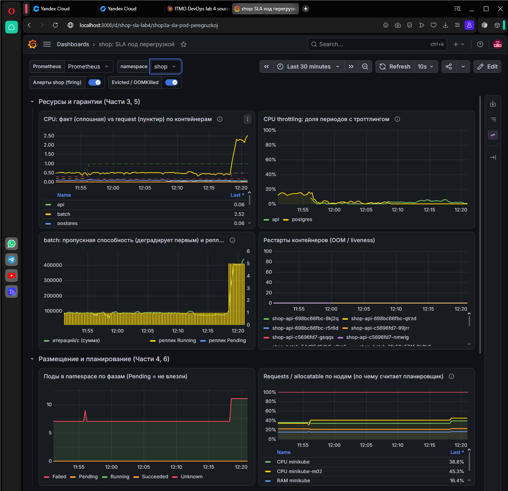

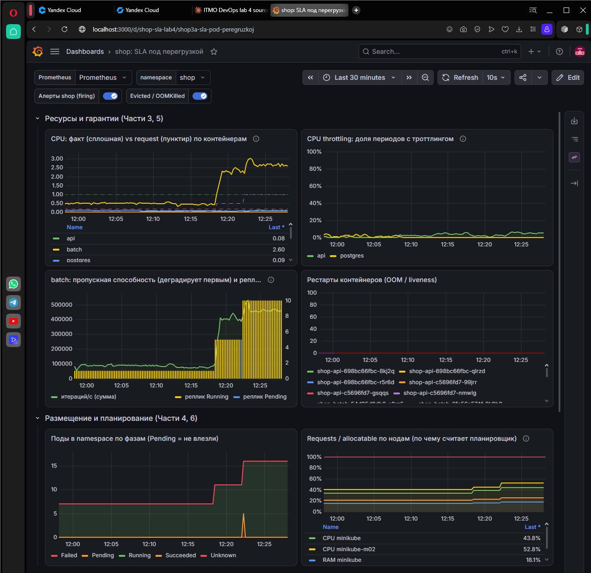

Фактический CPU batch вырос до ~2,5–3 ядер, а троттлинг `api` и `postgres` остался в районе 0–5%. `api` получает CPU пропорционально своим requests, а свой потолок у него с запасом.

### Находка: фон приоритетнее платформы

Тут я поймал ошибку в собственной схеме приоритетов. Изначально у `shop-background` было value **1000**. При rolling update batch планировщик начал **вытеснять поды мониторинга и Kyverno**

Причина простая: у подов без priorityClass приоритет **0**. Исправил на **-1000**. Больше по `monitoring`/`kyverno` ничего не вытеснялось.

Но последствие осталось: `prometheus-0` был пересоздан в 12:29:39, а у него `emptyDir` вместо постоянного тома. **История метрик до 12:30 пропала** — поэтому на всех следующих графиках данные начинаются с 12:30:

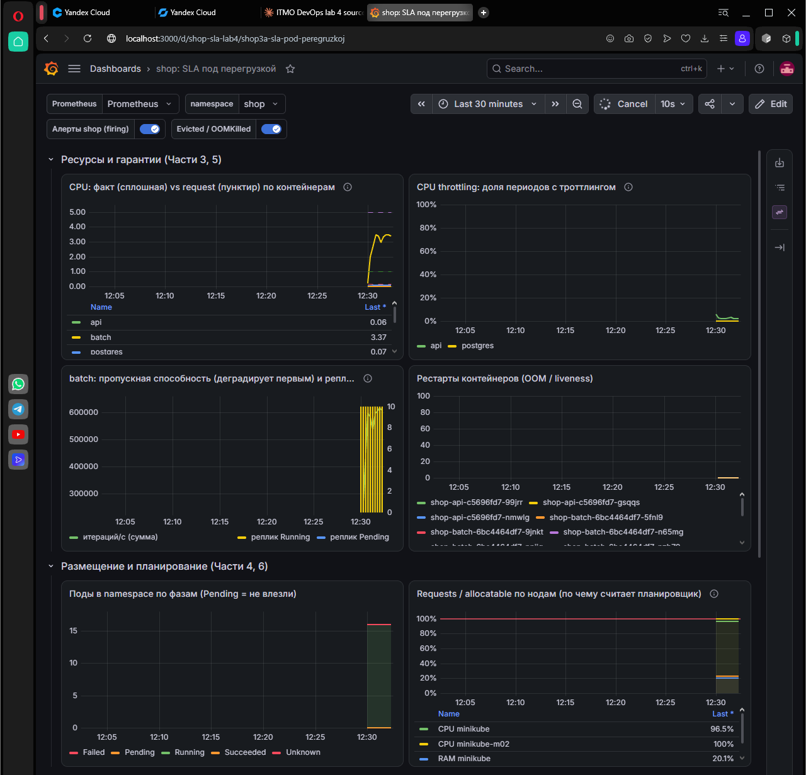

Выводы для прода: у Prometheus должен быть PVC, у мониторинга и Kyverno — свой PriorityClass (например `system-cluster-critical`), а "низкий" приоритет фона должен быть ниже дефолтного 0, а не просто ниже критического.

### Pending

`batch.replicas = 14`. Requests по CPU: `minikube` 96,5%, `minikube-m02` 100%. Итог: **10 Running + 4 Pending**:

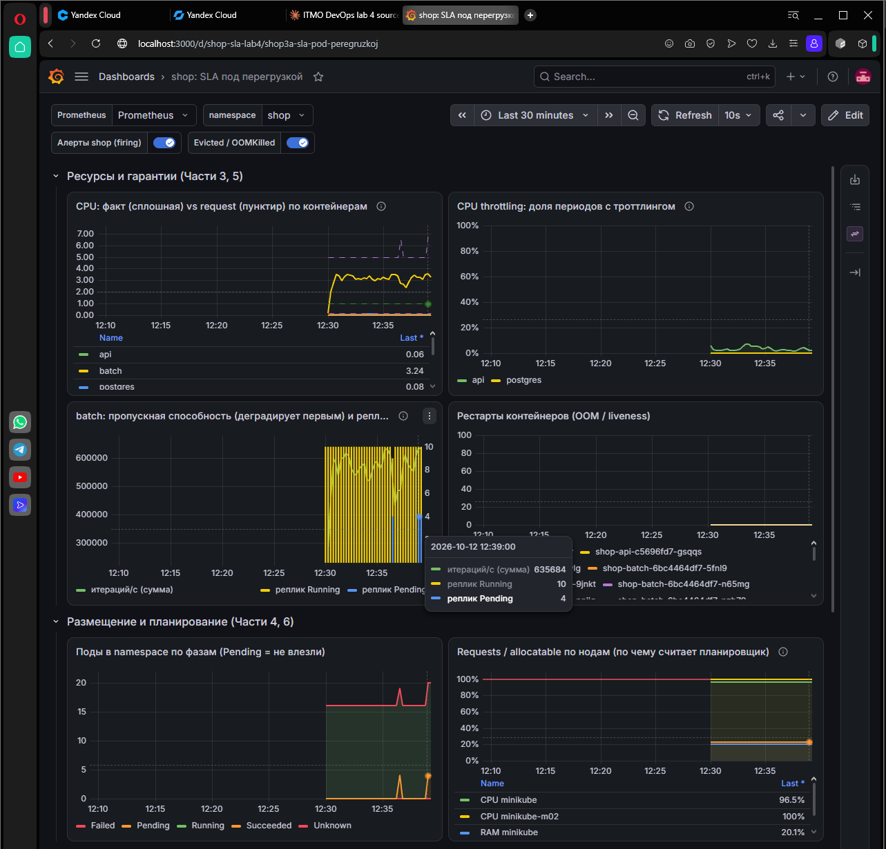

```bash
kubectl -n shop describe pod shop-batch-f66bfcf-959c9 | sed -n '/Events/,$p'
```

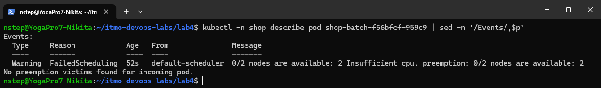

`0/2 nodes are available: 2 Insufficient cpu. preemption: 0/2 nodes are available: 2 No preemption victims found for incoming pod.`

Что здесь важно:
- **планировщик считает по requests, а не по факту.** На панели "Requests / allocatable" ноды на 96–100%, хотя фактически процессор не весь занят. Новому поду нужно 500m свободных **requests**, а их нет ни на одной ноде
- `No preemption victims found` — у batch приоритет -1000, ниже всех в кластере. Вытеснить ему некого

Количество Pending растёт на графике фаз:

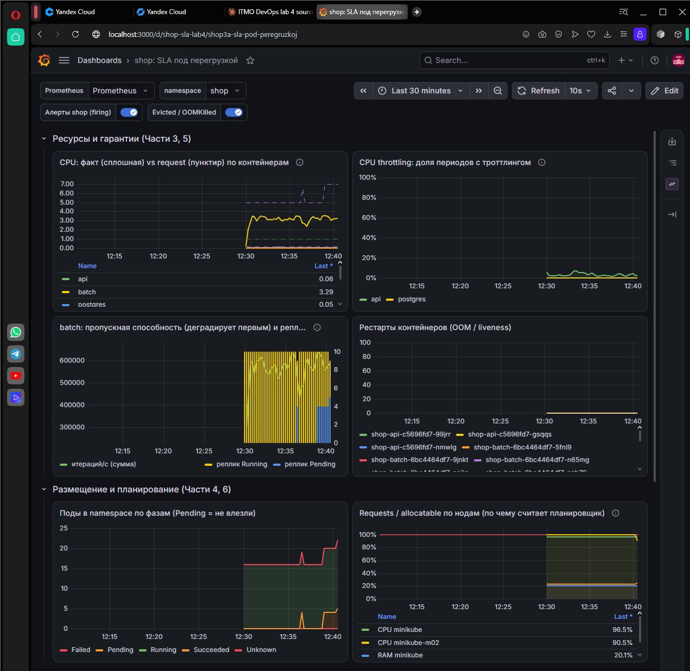

### Preemption

Теперь `api.replicas` 3 → 5. Новые поды `api` (`shop-critical`, 100000) тоже не помещаются по CPU — но им есть кого вытеснить:

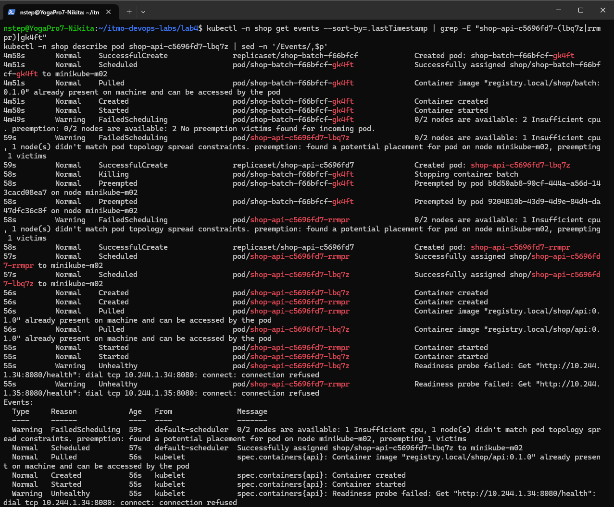

По порядку:
1. `shop-batch-f66bfcf-gk4ft`: `Preempted by pod ... on node minikube-m02` → `Killing`
2. новые `shop-api-...-lbq7z` и `-rrmpr` `Scheduled` на `minikube-m02` и стартуют
3. ReplicaSet `batch` создаёт замену вытесненному поду, и она уходит в `Pending` — места для неё больше нет

## Часть 7 — Давление по памяти

Здесь два разных опыта, потому что нужно было отличить два диагноза с одинаковым симптомом.

### Опыт 1 — OOMKilled по собственному лимиту

`batch.memTargetMB = 700` при `limits.memory = 560Mi`. За минуту все три пода batch ушли в `OOMKilled` (Exit 137), дальше рестарты и CrashLoop:

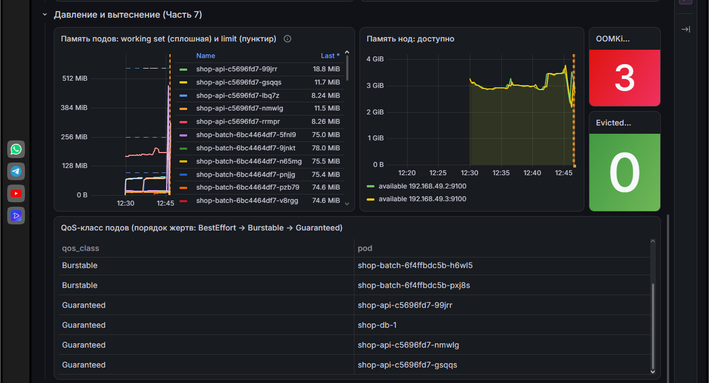

`OOMKilled = 3`, `Evicted = 0`. Память нод при этом в порядке (≈ 3 GiB свободно). `api`, `postgres`, `worker` — ни одного рестарта, p95 ровный. Убило **ядро** по cgroup-лимиту **самого контейнера**: под превысил то, что сам себе заявил. Нода здорова, соседи даже не заметили.

### Опыт 2 — eviction под давлением на ноду

Теперь надо, чтобы под **не** упирался в свой лимит, но ноде стало плохо. `limits.memory` у batch 1500Mi, `memTargetMB = 700`, 3 пода.

И тут WSL подкинул сюрприз. Я поднял `memory.available` у kubelet до 2Gi — и ничего. Оказалось, kubelet считает `memory.available` не по хосту (как `free` или node-exporter), а по **cgroup своей ноды**. Обе "ноды" minikube — контейнеры на одной WSL-VM, и каждая видит только свои поды.

После этого:

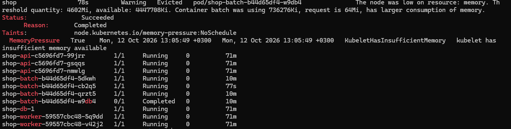

```
Warning  Evicted  pod/shop-batch-b44d65df4-w9db4
The node was low on resource: memory. Threshold quantity: 4602Mi, available: 4447708Ki.
Container batch was using 736276Ki, request is 64Mi, has larger consumption of memory.
```

- нода `MemoryPressure = True`, на неё повесился taint: `node.kubernetes.io/memory-pressure:NoSchedule`;
- выселен **batch**: Burstable, приоритет -1000, использует 719 Mi при request 64Mi — превысил больше всех. kubelet даже пишет это прямым текстом: `has larger consumption of memory`;
- `api` × 3, `shop-db-1`, `worker` × 2 — Running, 0 рестартов. Guaranteed с приоритетом 100000 в очередь жертв даже не попали.

### OOMKilled vs eviction vs preemption

Симптом у всех трёх похожий: под с batch исчез или перезапустился. Но диагнозы совершенно разные:

| | OOMKilled | Eviction (node-pressure) | Preemption |
|---|---|---|---|
| Кто | ядро (cgroup OOM) | kubelet | планировщик |
| Почему | контейнер превысил **свой** `limits.memory` | на **ноде** кончается память (порог `evictionHard`) | высокоприоритетному поду нужно место по **requests** |
| Состояние ноды | здорова | `MemoryPressure`, taint | здорова |
| Что с подом | контейнер перезапускается в том же поде (`Exit 137`, `restartCount++`) | под завершён (`Failed`/`Evicted`), ReplicaSet создаёт новый, возможно на другой ноде | под удалён (`Preempted`), новый может уйти в `Pending` |
| Где смотреть | `lastState.terminated.reason: OOMKilled` | событие `Evicted`, условия ноды | событие `Preempted by pod ...` |
| Как чинить | поднять лимит или найти утечку | requests, ближе к реальности, больше памяти на ноде, правильный QoS/приоритет | больше мощности или пересмотреть приоритеты |

Главное: на OOMKilled QoS и приоритет **не влияют** — ядро убивает конкретный контейнер за его собственное превышение. А eviction и preemption — это как раз тот случай, где QoS и приоритет решают, кто пострадает.

## Часть 8 — SLA под нагрузкой

### SLA

> **95% заказов (`POST /order`) обрабатываются быстрее 300 мс, и доля ошибок меньше 1% — даже когда batch перегружает кластер.**

### Результат

`hey` работал непрерывно с 12:08 до 13:19, через все эксперименты Частей 6–7 (рост batch, Pending, preemption, OOMKilled, eviction):

| | |
|---|---|
| ответов | 876 140, **все `201`**, ни одной 4xx/5xx |
| p50 | 11,5 мс |
| p90 | 44,6 мс |
| **p95** | **71,0 мс** |
| p99 | 160,1 мс |
| самый медленный | 2,30 с (единичные выбросы) |

Графики SLA-блока дашборда:

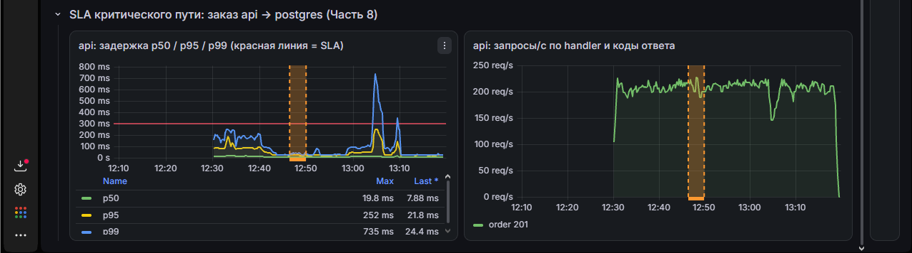

- задержка p95 максимум **252 мс** — ниже красной линии 300 мс за всё окно
- коды ответа — только `order 201`, ни одного 5xx
- самый заметный эпизод — около 13:05, опыт B (eviction): p99 подскакивает до 735 мс, трафик проседает с ~210 до ~145 req/s. Ошибок нет, p95 в SLA
- обрыв в 13:19 — это я остановил `hey` перед Частью 9, чтобы авария БД не попала в итог

### А что деградировало

Всё время деградировал **batch**:
- в Части 6 4 реплики из 14 стоят в `Pending`, одна вытеснена ради `api`
- в Части 7 — OOMKilled в опыте A и eviction в опыте B
- пропускная способность batch (панель "batch: пропускная способность") проседала при каждом вытеснении

А критический путь на тех же скриншотах: троттлинг `api` 0–5%, `postgres` 0%, рестартов у `api`/`postgres`/`worker` нет

## Часть 9 — Мониторинг

### ServiceMonitor, PrometheusRule, дашборд

- [`servicemonitor.yaml`](./chart/shop/templates/servicemonitor.yaml) — один ServiceMonitor на `api`, `worker`, `batch`
- [`prometheusrule.yaml`](./chart/shop/templates/prometheusrule.yaml) — три алерта
- [`dashboard.yaml`](./chart/shop/templates/dashboard.yaml) + [`dashboards/shop.json`](./chart/shop/dashboards/shop.json) — дашборд "shop: SLA под перегрузкой"

### Алерты

**1. `ShopApiHighErrorRate`** — доля 5xx у `api` (без `/health`) > 5% за 2 минуты, `for: 2m`. Это алерт на **симптом** — то, что видит пользователь. Доля, а не абсолютное число: 10 ошибок при 200 RPS и при 2 RPS — это разные ситуации. `/health` исключён: его дёргают пробы, и он не зависит от БД.

**2. `ShopDatabaseUnavailable`** — `max(api_db_ready) == 0`, `for: 1m`. **Ни одна** реплика `api` не видит postgres. Это алерт на **причину**: когда прилетает алерт №1, сразу понятно, что дело в базе, а не в коде. `max`, а не `min` — проблема у одной реплики это не авария БД.

**3. `ShopWorkerStalled`** — `time() - max(worker_last_success_timestamp_seconds) > 60`, `for: 1m`. **Тихая** поломка: `worker` жив, `/health` отвечает, пользователь получает свой `201`... а заказы копятся в статусе `new`. Без отдельного алерта такое можно не заметить вообще.

Все три `critical`: в первом и третьем случае ломается работа с заказами для пользователя, второй объясняет первые два.

Через ~2 минуты в Karma `ShopDatabaseUnavailable` и `ShopWorkerStalled` в firing, `severity: critical`, `@receiver: webhook`:

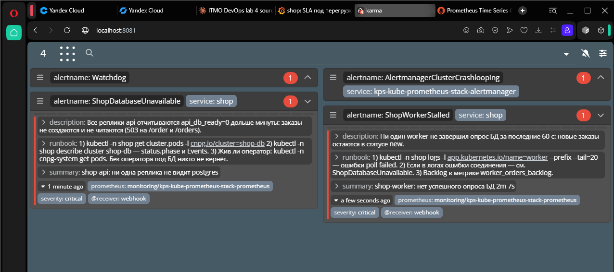

## Итоговые значения

```yaml
api:      {replicas: 3, requests/limits: {cpu: 60m, memory: 100Mi}}                    # Guaranteed, shop-critical
database: {instances: 1, requests/limits: {cpu: 1000m, memory: 256Mi}}                 # Guaranteed, shop-critical
worker:   {replicas: 2, requests: {cpu: 10m, memory: 100Mi}, limits: {memory: 100Mi}}  # Burstable, shop-critical
batch:    {replicas: 3, requests: {cpu: 500m, memory: 64Mi}, limits: {memory: 560Mi}}  # Burstable, shop-background
priority: shop-critical = 100000, shop-background = -1000
pdb:      shop-api (maxUnavailable 1), shop-db-primary-pdb (minAvailable 1)
placement: topologySpread, maxSkew 1, DoNotSchedule
```

## Вывод

Что получилось:
- реплики `api` разнесены по двум нодам через topologySpread, и это видно и в `get pods -o wide`, и в событиях preemption
- requests/limits критического пути взяты из krr, а там, где я от него отошёл (CPU `api`, `postgres`)
- у всех подов, включая batch, есть лимиты — Kyverno иначе бы не пропустил
- Pending и preemption увидены вживую
- eviction под давлением по памяти забрал batch, а Guaranteed-поды даже не перезапустились
- SLA p95 < 300 мс выдержан под всем этим: 876 тыс. заказов, 0 ошибок, p95 71 мс

Главные уроки лабы:
- **планировщик живёт в мире requests, ядро — в мире факта.** Pending при свободном процессоре и OOM при "свободной" ноде — следствие этого разрыва
- **"низкий приоритет" должен быть ниже нуля.** Иначе фон вытесняет мониторинг и Kyverno
- **CPU limit = жёсткий потолок.** У Guaranteed это цена гарантии, а у пода с пробами — ещё и риск рестартов
- **krr даёт request, а не limit.** Для Guaranteed его число надо осмысленно превращать в потолок
- **OOMKilled, eviction и preemption выглядят одинаково, но лечатся по-разному** — смотреть надо на reason и на то, кто принял решение
