# Лаба 5 — Zero-trust сеть с доказательством

Задание: https://github.com/KeladKaal/containerization-and-orchestration/blob/main-rus/lecture-5-kubernetes-networking/lab.md

## Предисловие

После четвёртой лабы я уже научился заставлять кластер решать, кем пожертвовать. А вот сеть в кластере до сих пор была для меня штукой, которая «просто работает». Под стучится в `shop-db` и попадает в базу. Как именно — магия 🪄

> Спойлер: магия закончилась примерно на первом `ip route` внутри пода.

Теперь задача двойная:

1. Доказать, что `Service` держит `shop` на плаву, даже если поды под ним непрерывно убивают
2. Закрутить гайки до нулевого доверия: по умолчанию запрещено всё, открыто только то, что реально нужно

Площадка та же, что в конце Лабы 4 (после того как Яндекс Облако со мной попрощалось)

Чарт скопирован из Лабы 4 в [`./chart/shop`](./chart/shop) (версия `0.5.0`). `batch` выключен (`replicas: 0`).

## Часть 0 — Выбор CNI

minikube для кластера из нескольких нод по умолчанию ставит **kindnet**. Он раздаёт подам IP и прописывает маршруты между нодами, а NetworkPolicy принимает. Именно принимает: `kubectl apply` проходит, объект в кластере лежит, а трафик бегает как бегал. 

> Хуже отсутствия безопасности может быть только иллюзия безопасности.


Выбирал между Cilium и Calico. Выбор пал на **Cilium**:

| | Cilium | Calico |
|---|---|---|
| Как применяет политики | eBPF-программы на интерфейсах подов | iptables |
| Карта трафика | **Hubble** из коробки есть UI и метрики | есть логи, но удобного UI нет |
| Идентичность | по **меткам** пода, а не по IP | по IP через ipset |
| L7-политики | есть (HTTP, DNS) | только в Enterprise / через Envoy |
| Метрики для Prometheus | агент + Hubble (дропы, TCP, потоки) | Felix-метрики, без разбивки по потокам |

Решающими стали два пункта из самой работы, чтобы было удобнее:
- **Часть 6 требует найти поломку «по карте трафика».** С Hubble эта карта есть с самого начала, и каждый дроп подписан причиной (`POLICY_DENIED`) и направлением (`INGRESS`/`EGRESS`)
- **Часть 7 требует метрики отклонённого трафика.** У Cilium из коробки есть `hubble_drop_total{reason="POLICY_DENIED"}` с разбивкой по источнику и назначению

### Установка

Конфиг: [`install/cilium-values.yaml`](./install/cilium-values.yaml). Главное в нём:

| Параметр | Значение | Зачем |
|---|---|---|
| `kubeProxyReplacement` | `"false"` | kube-proxy остаётся, его режим нужен в Части 2 |
| `ipam.mode` | `kubernetes` | IP подов берутся из `podCIDR` нод (`10.244.0.0/24`, `10.244.1.0/24`), как было у kindnet. |
| `routingMode: native` + `autoDirectNodeRoutes` | | ноды в одной docker-сети `192.168.49.0/24`, туннель (VXLAN) не нужен |
| `cni.exclusive` | `true` | Cilium переименовал конфиг kindnet в `.cilium_bak`, чтобы тот случайно не ожил |
| `hubble.relay/ui` | on | карта трафика |

Переводим существующий кластер на новый CNI:

```bash
# 1. удаление kindnet (DaemonSet + RBAC)
kubectl -n kube-system delete ds kindnet
kubectl -n kube-system delete sa kindnet
kubectl delete clusterrolebinding kindnet; kubectl delete clusterrole kindnet

# 2. установка Cilium
helm repo add cilium https://helm.cilium.io/
helm upgrade --install cilium cilium/cilium --version 1.20.2 -n kube-system -f install/cilium-values.yaml

# 3. рестарт кластера
minikube stop && minikube start
```

### Что поймал

**minikube очень хочет вернуть kindnet.** В логах `minikube start` каждый раз пишет `multinode detected, recommending kindnet`, но на существующий кластер его не накатывает.

## Часть 1 — Как под получает сеть

Разбирал под `api` на ноде `minikube`. Заходил в его сетевой namespace через `nsenter` от PID контейнера, который берётся из `crictl inspect`. Все команды в одном скрипте: в одном окне — что видно изнутри пода, что на ноде и как под достаёт до соседней ноды.

> Забыл сделать его сразу, поэтому скриншот снят уже в конце лабы, после перезапуска кластера, поэтому IP и номера интерфейсов здесь другие, чем в дальнейших частях отчета. Но суть та же.

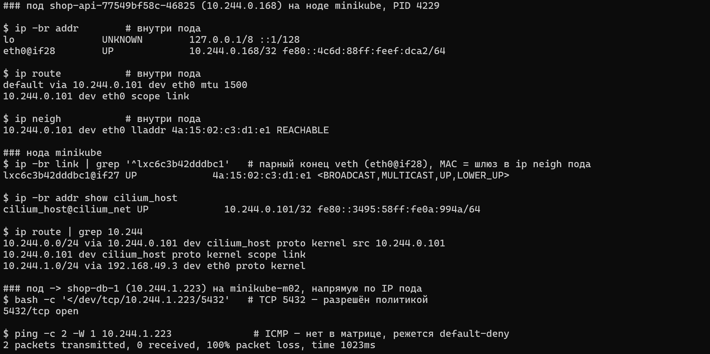

### Внутри пода

```
eth0@if28        UP   10.244.0.168/32
default via 10.244.0.101 dev eth0 mtu 1500
10.244.0.101 dev eth0 scope link
10.244.0.101 dev eth0 lladdr 4a:15:02:c3:d1:e1 REACHABLE
```

- маска **/32**: у пода нет «своей подсети», любой адрес для него чужой и идёт через шлюз
- шлюз `10.244.0.101` — это адрес интерфейса `cilium_host` на ноде, общий шлюз для всех подов ноды
- `@if28` — номер парного интерфейса на ноде

В первый раз я тут ошибся: сделал на ноде `grep` по номеру самого `eth0` и долго искал не тот интерфейс. Причём `cat /sys/class/net/eth0/iflink` через `nsenter -n` тоже врёт: sysfs остаётся нодовым, и ты читаешь `eth0` ноды, а не пода.

На ноде интерфейс 28:

```
lxc6c3b42dddbc1@if27   UP   4a:15:02:c3:d1:e1
```

Это и есть второй конец veth-пары. У Cilium они называются `lxc…`, а `@if27` смотрит обратно на `eth0` пода.

Дальше интересное. В ARP-таблице пода шлюз `10.244.0.101` резолвится в MAC `4a:15:02:c3:d1:e1` — а это MAC `lxc`-конца, а не `cilium_host`. На ARP отвечает eBPF-программа, висящая на `lxc`. `cilium_host` в L2-жизни пода вообще не участвует, он просто «адрес на бумаге».

### На ноде

У kindnet на ноде были маршруты на каждый под (`10.244.0.X dev vethY`). У Cilium их **нет**:

```
10.244.0.0/24 via 10.244.0.101 dev cilium_host     # свои поды
10.244.0.101 dev cilium_host scope link
10.244.1.0/24 via 192.168.49.3 dev eth0            # поды соседней ноды — напрямую через её IP
```

Как тогда пакет находит нужный под? Через BPF-таблицу эндпоинтов:

```bash
kubectl -n kube-system exec ds/cilium -c cilium-agent -- cilium-dbg bpf endpoint list
```

Это и есть замена per-pod маршрутам: «этот IP — на такой-то интерфейс».

### Поды на разных нодах видят друг друга напрямую

Из `api` (нода `minikube`) открывается TCP-соединение прямо на IP пода `shop-db-1` (`10.244.1.223`, нода `minikube-m02`), порт 5432. Никакого Service, никакого NAT по дороге: внутри `10.244.0.0/16` адреса не транслируются, SNAT под IP ноды бывает только при выходе во внешний мир.

А вот `ping` на скриншоте **не проходит**. Скриншот снят с включёнными политиками из Части 4, а ICMP в матрице доступа нет, так что default-deny его режет. Это побочный пруф, что zero-trust работает даже для «безобидного» пинга

### Identity

```bash
cilium-dbg endpoint list
```

Все три пода `api` получили **одну** identity `20170`, хотя у них разные IP и они на разных нодах. `worker` — `12661`, `shop-db-1` — `27138`. Identity — это функция от меток пода (`app.kubernetes.io/*`, namespace, serviceaccount), и именно по ней Cilium потом проверяет политики. `pod-template-hash` в identity не входит, иначе каждый rollout давал бы новую identity.

Служебные identity: `1` = `reserved:host` (нода), `4` = `reserved:health`.

`Enforcement: Disabled` у всех эндпоинтов: политик пока нет, сеть плоская, под никак не изолирован.

## Часть 2 — Непрерывность через хаос

### NodePort для api

В [`values.yaml`](./chart/shop/values.yaml):

```yaml
api:
  service:
    type: NodePort
    nodePort: 30080
    externalTrafficPolicy: Local   # зачем Local — в Части 4
```

### NodePort vs LoadBalancer vs headless

| | NodePort | LoadBalancer | Headless (`clusterIP: None`) |
|---|---|---|---|
| Что получаем | порт 30000–32767 на **каждой** ноде | внешний IP от облачного балансировщика | **нет** виртуального IP |
| Как устроен | ClusterIP + правило на каждой ноде | NodePort + внешний балансировщик перед нодами | DNS отдаёт IP подов напрямую |
| Кто балансирует | kube-proxy на ноде | внешний LB между нодами, затем kube-proxy | клиент сам выбирает из списка IP |

В minikube без `minikube tunnel` `LoadBalancer` так и висел бы в `<pending>`, поэтому NodePort.

### Клиент: loadgen

Задание просит гнать нагрузку **по имени сервиса**. `hey` из Лабы 4 не подошёл: DNS-имя Service резолвится только внутри кластера, Kyverno пускает только образы `registry.local/shop/*`, а временной ряд ошибок `hey` не даёт — только итог в конце.

Так что появился маленький сервис [`loadgen`](./loadgen) на Go. Ходит на `TARGET_URL` с заданным `RPS` и считает:

- `loadgen_requests_total{result=ok|http_error|timeout|conn_error|skipped}`
- `loadgen_request_duration_seconds`
- `loadgen_inflight_requests`.

`KEEPALIVE=false`: каждый запрос — новое TCP-соединение, иначе соединение прилипнет к одному поду и смерть других клиент не заметит.

### Базовая линия оказалась не нулевой

Прежде чем убивать поды, надо убедиться, что без хаоса ошибок ноль. Иначе хаос будет виноват во всём подряд. И — сюрприз:

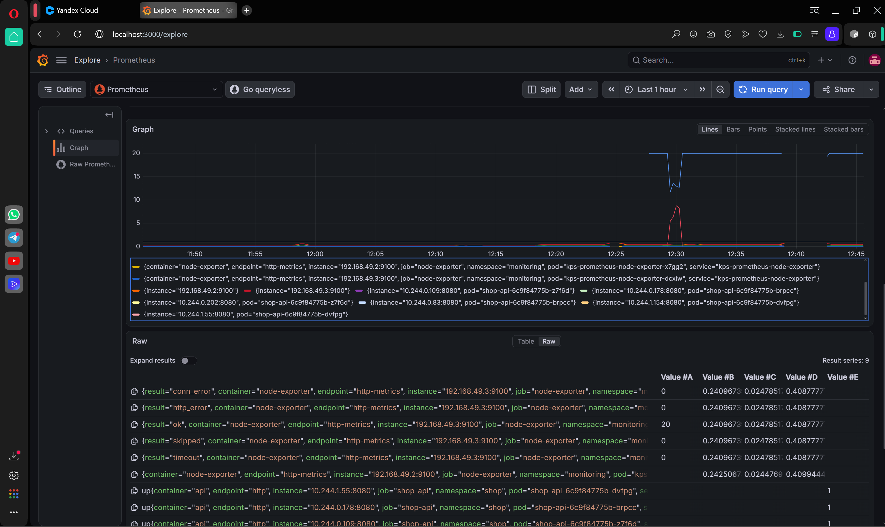

**434 таймаута за 50 секунд** (12:29 MSK), а хаос ещё даже не запускался. Ошибки смешанные: `lookup … i/o timeout` и `Client.Timeout … awaiting headers`. В событиях `shop` пусто.

Проверил очевидное: PSI по CPU/IO/памяти, загрузку нод, скрейпы — в провале всё как в тихом окне. Нода здорова.

**Догадка №1 — DNS умножает запросы.** 

В `resolv.conf` loadgen:

```
search shop.svc.cluster.local svc.cluster.local cluster.local
options ndots:5
```

В имени `shop-api.shop.svc.cluster.local` 4 точки, это меньше 5. Поэтому резолвер сначала честно пробует дописать все три суффикса из `search` (3 × NXDOMAIN) и только потом спрашивает имя как есть. Умножаем на A + AAAA — **8 DNS-запросов на один заказ**. При 20 RPS без keep-alive это ~160 DNS-запросов в секунду.

**Улика №2 — лог агента Cilium.** 

На ноде loadgen ровно через 2 секунды после конца провала:

```
Starting GC of connection tracking
```

А интервал GC перед этим был **25 минут 20 секунд**.

**Механизм.** Cilium хранит каждый поток (в том числе UDP-«соединение» DNS-запроса) в своей conntrack-таблице — CT map. Её размер считается от памяти: у меня вышло 65 536 записей для не-TCP. Пока трафика было мало, Cilium решил, что чистить таблицу часто незачем, и растянул интервал GC до 25 минут. Потом пришёл loadgen и начал добавлять сотни UDP-записей в секунду. Карта заполнилась за минуты → новые DNS-потоки не влезают в таблицу → пакеты дропаются → таймауты. GC отработал → место освободилось → всё снова работает.

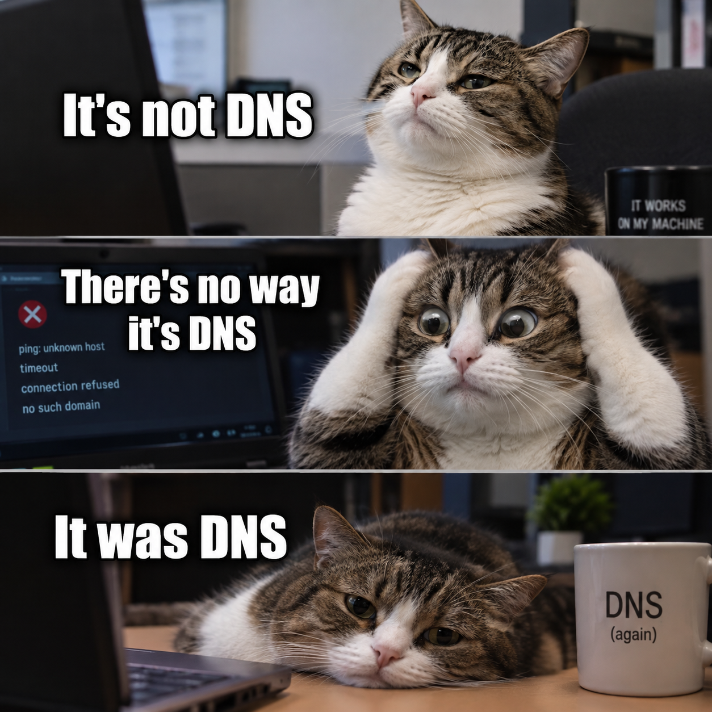

Контрольное окно 10 минут после фикса: **12 000 ok, 0 ошибок**. Теперь базовая линия чистая, можно ломать.

### chaos.sh

> "Let the chaos reign, then reign in chaos"
> — Эндрю Гроув, сооснователь корпорации Intel

Скрипт: [`chaos.sh`](./chaos.sh). Использование 

```bash
`./chaos.sh <интервал> <длительность>`.
```

- выбирает кандидатов через go-template: поды `api`/`worker`, `Ready=True` и без `deletionTimestamp` (чтобы не «убивать» уже умирающий под)
- случайный под через `shuf`, удаление `kubectl delete pod --wait=false`: под проходит нормальное завершение с preStop
- лог в UTC с IP и нодой убитого пода
- на выходе (в том числе по Ctrl+C) печатает итог через `trap summary EXIT`

Поды перед запуском:

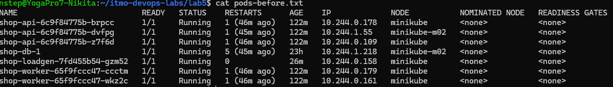

### Боевой прогон

`./chaos.sh 10 600` — каждые 10 секунд, 10 минут, 13:27–13:37 MSK:

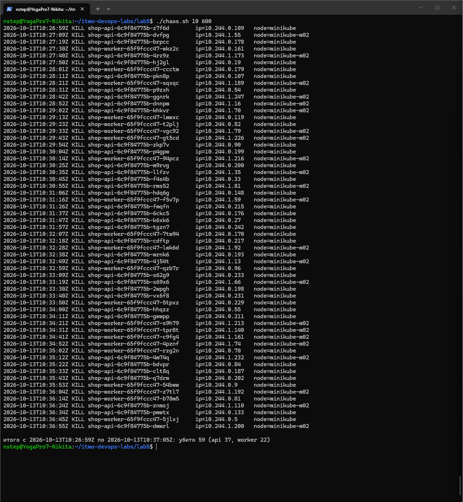

**Убито 59 подов** (api 37, worker 22). Каждая замена получала новое имя и новый IP — например `api` переезжал между `10.244.0.x` и `10.244.1.x`, то есть и между нодами.

Один график, три линии:

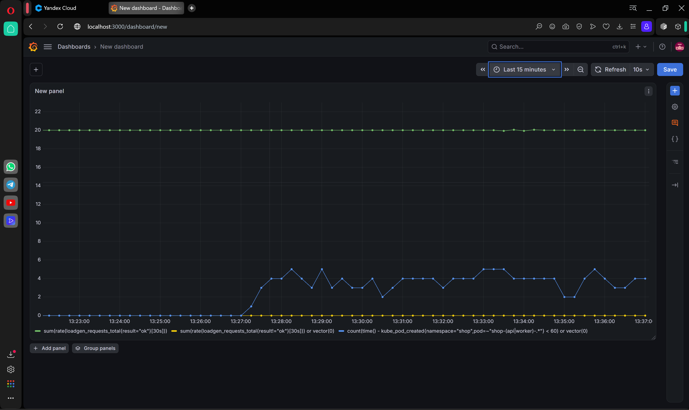

- **зелёная** — `sum(rate(loadgen_requests_total{result="ok"}[30s]))`: 20 req/s весь прогон
- **жёлтая** — `sum(rate(loadgen_requests_total{result!="ok"}[30s])) or vector(0)`: **0** все 10 минут.
- **синяя** — количество подов `api`/`worker` моложе 60 секунд: с 13:27 постоянно 2–5 свежих подов


### kube-proxy: iptables

```bash
kubectl -n kube-system get cm kube-proxy -o yaml | grep mode   # mode: iptables
```

Посмотрел цепочки на ноде для NodePort 30080:

- `KUBE-NODEPORTS` — два правила на 30080 (отдельное для `127.0.0.0/8` — NodePort на localhost) → `KUBE-EXT-…`
- `KUBE-EXT-…` — `KUBE-MARK-MASQ`, то есть SNAT под IP ноды. Без него ответ мог бы уйти мимо ноды, на которой был сделан DNAT, и клиент получил бы ответ «не от того»
- `KUBE-SVC-…` — выбор пода по **вероятностям**: `0.333`, потом `0.5`, потом без условия. Получается равномерно 1/3–1/3–1/3: правила проверяются по очереди, и каждая вероятность условная
- `KUBE-SEP-…` — DNAT в IP конкретного пода

**Когда разница iptables vs IPVS (и nftables) заметна:**
- iptables — линейный список правил, и при каждом изменении EndpointSlice kube-proxy перезаписывает таблицу целиком через `iptables-restore`
- IPVS — хеш-таблицы в ядре, поиск O(1), обновление точечное, плюс нормальные алгоритмы балансировки (least connections и т.д.)
- на трёх подах и двух нодах разницы нет никакой

Общее для обоих: решение о бэкенде принимается на **первом** пакете и запоминается в conntrack. Установленные TCP-соединения к убитому поду kube-proxy не чистит, они рвутся. Поэтому keep-alive клиент заметил бы хаос сильнее, чем мой.

### Поправка, которую я нашёл в Части 3

Потом выяснилось, что для моего loadgen kube-proxy почти ни при чём. Счётчики правил `KUBE-SVC-…` для `shop-api` за 30 секунд при 20 соединениях/с — **ноль**. А `cilium-dbg service list` показывает тот же ClusterIP.

То есть трафик **из пода** к ClusterIP балансирует Cilium в eBPF прямо на `lxc`-интерфейсе, ещё до iptables, даже при `kubeProxyReplacement: false`. kube-proxy обслуживает только трафик с самих нод: NodePort, hostNetwork-поды, `curl` с ноды. Оба читают одни и те же EndpointSlice, поэтому вывод про непрерывность не меняется.

## Часть 3 — Целевая матрица доступа

Матрицу рисовал не из головы, а по факту. Записал Hubble-ом 5 минут трафика `shop` (≈ 95 тыс. потоков) и вытащил оттуда все рёбра «кто → кому:на каком порту».

Что увидел:
- `kubelet` (identity `host`) → `api`/`worker`/`loadgen`:8080 и `postgres`:8000 — это пробы
- `monitoring/prometheus` → `api`/`worker`/`loadgen`:8080 — скрейп
- `loadgen` → `kube-dns`:53/UDP, `loadgen` → `api`:8080
- `api` → `postgres`:5432, `worker` → `postgres`:5432
- `postgres` → `kube-apiserver`:**8443** — CNPG

Первый черновик составил с ошибками:
- `postgres → api ✅` — перепутал ответ и соединение. Политики stateful: ответ проходит по записи в conntrack, отдельно разрешать его не надо
- `api/worker → интернет ✅` — ни одного такого ребра в факте нет. Это готовый канал утечки данных
- `api → worker ✅` — они вообще не общаются напрямую, только через таблицу в БД
- галочки без портов. Правило без порта открывает **все** порты пода

### Итоговая матрица

Строка = кто инициирует. ✅ — разрешено (с портом), ❌ — запрещено, «—» — не наша зона.

| источник ↓ / назначение → | api | worker | postgres | loadgen | kube-dns | kube-apiserver | интернет |
|---|---|---|---|---|---|---|---|
| внешний клиент (NodePort) | ✅ 8080/TCP | ❌ | ❌ | ❌ | — | — | — |
| loadgen | ✅ 8080/TCP | ❌ | ❌ | — | ✅ 53/UDP+TCP | ❌ | ❌ |
| api | — | ❌ | ✅ 5432/TCP | ❌ | ✅ 53/UDP+TCP | ❌ | ❌ |
| worker | ❌ | — | ✅ 5432/TCP | ❌ | ✅ 53/UDP+TCP | ❌ | ❌ |
| postgres | ❌ | ❌ | — | ❌ | ❌ | ✅ 8443/TCP | ❌ |
| monitoring/prometheus | ✅ 8080/TCP | ✅ 8080/TCP | ❌ | ✅ 8080/TCP | — | — | — |
| cnpg-system/operator | ❌ | ❌ | ✅ 8000/TCP | ❌ | — | — | — |
| kubelet (нода) | ✅ 8080/TCP | ✅ 8080/TCP | ✅ 8000/TCP | ✅ 8080/TCP | — | — | — |
| **посторонний под** | ❌ | ❌ | ❌ | ❌ | — | — | — |

### Зачем каждая ✅

| Ребро | Зачем | Что сломается без него |
|---|---|---|
| клиент → api:8080 | точка входа | весь сервис |
| api → postgres:5432 | запись заказа | `POST /order` → 5xx |
| worker → postgres:5432 | обработка заказов | **тихо**: заказы копятся в `new`, горит `ShopWorkerStalled` |
| api/worker/loadgen → kube-dns:53 UDP+TCP | резолв имён. TCP — когда ответ не влезает в UDP | клиент не находит api; пулы к БД живут до первого переподключения |
| postgres → kube-apiserver:8443 | CNPG instance manager следит за ресурсом `Cluster` | оператор теряет контроль: failover |
| prometheus → api/worker/loadgen:8080 | скрейп `/metrics` | графики и алерты слепнут при живых заказах |
| operator → postgres:8000 | опрос статуса инстанса | `Cluster` в непонятном состоянии при работающем SQL |
| kubelet → всё | liveness/readiness | поды выпадают из EndpointSlice и рестартуют |

Почему **8443**, а не 443: под стучится в `kubernetes.default` = `10.96.0.1:443`, но Cilium разворачивает ClusterIP в реальный адрес apiserver (`192.168.49.2:8443`) **до** проверки egress-политики. Политика видит уже настоящий порт.

## Часть 4 — Включаем zero-trust

### externalTrafficPolicy: Local

Сначала надо было решить вопрос с NodePort-клиентом. Варианты:

| Вариант | Минус |
|---|---|
| CiliumNetworkPolicy `fromEntities: [remote-node]` | разрешает всё с нод. Посторонний под может «отмыть» свой трафик: сходить на NodePort, получить SNAT под IP ноды и пройти как «нода» |
| ipBlock ноды + `policyCIDRMatchMode: nodes` | та же проблема |
| **`externalTrafficPolicy: Local`** | NodePort отвечает только на нодах, где есть под `api` |

Выбрал `Local`. Без SNAT виден настоящий IP клиента, и в Hubble это стало `192.168.49.1 (world) → shop-api:8080`. Такой клиент описывается обычным `ipBlock: 192.168.49.1/32` (`networkPolicy.clientCIDRs` в values). `api` есть на обеих нодах, так что минус Local мне не мешает.

### Шаг 1: только default-deny

[`networkpolicy-default-deny.yaml`](./chart/shop/templates/networkpolicy-default-deny.yaml) — `podSelector: {}`, `policyTypes: [Ingress, Egress]`, правил нет. 

Ещё увидел `shop-db-1 → 192.168.49.2:8443 EGRESS DENIED` — это подтвердило и порт 8443, и то, что apiserver в Cilium — это IP ноды.

### Шаг 2: точечные разрешения

Все значения — в блоке `networkPolicy` в [`values.yaml`](./chart/shop/values.yaml):

```yaml
networkPolicy:
  enabled: true
  clientCIDRs: [192.168.49.1/32]
  dns:
    enabled: true
    clients: [api, worker, loadgen]
    namespace: kube-system
    podLabels: {k8s-app: kube-dns}
    port: 53
  monitoring:
    namespace: monitoring
    podLabels: {app.kubernetes.io/name: prometheus}
  cnpgOperator:
    namespace: cnpg-system
    podLabels: {app.kubernetes.io/name: cloudnative-pg}
  database:
    podLabels: {cnpg.io/cluster: shop-db, cnpg.io/podRole: instance}
    port: 5432
    statusPort: 8000
  apiServerPort: 8443
```

Шаблоны:

| Файл | Что делает |
|---|---|
| [`networkpolicy-default-deny.yaml`](./chart/shop/templates/networkpolicy-default-deny.yaml) | запрет всего |
| [`networkpolicy-dns.yaml`](./chart/shop/templates/networkpolicy-dns.yaml) | `dns.clients` → kube-dns:53 UDP+TCP |
| [`networkpolicy-api.yaml`](./chart/shop/templates/networkpolicy-api.yaml) | вход: loadgen и `clientCIDRs` на 8080, prometheus на 8080; выход: postgres:5432 |
| [`networkpolicy-worker.yaml`](./chart/shop/templates/networkpolicy-worker.yaml) | вход: prometheus; выход: postgres:5432 |
| [`networkpolicy-loadgen.yaml`](./chart/shop/templates/networkpolicy-loadgen.yaml) | вход: prometheus; выход: api:8080 (только при `loadgen.enabled`) |
| [`networkpolicy-postgres.yaml`](./chart/shop/templates/networkpolicy-postgres.yaml) | вход: api/worker на 5432, оператор CNPG на 8000 |
| [`ciliumnetworkpolicy-postgres-apiserver.yaml`](./chart/shop/templates/ciliumnetworkpolicy-postgres-apiserver.yaml) | postgres → `toEntities: kube-apiserver` на 8443 |

Почему одна политика Cilium: apiserver живёт на IP ноды и имеет identity `kube-apiserver`, а `ipBlock` стандартной NetworkPolicy такие identity в Cilium не выбирает. Это единственное ребро, которое не выражается стандартными средствами.

### Результат

```bash
helm upgrade shop ./chart/shop -n shop --reset-values --wait   # revision 45
```

6 NetworkPolicy + 1 CiliumNetworkPolicy (`VALID: True`). Минута наблюдения в Hubble — **0 DROPPED** в `shop`; loadgen — 0 ошибок; `up=1` у всех 6 таргетов `shop`; NodePort → `200`; `shop-db` healthy. Включение всех политик разом прошло без единой ошибки клиента.

## Часть 5 — Матрица на практике

Инструменты:
- [`intruder.yaml`](./intruder.yaml) — «посторонний под» в отдельном namespace `intruder`. Образ — тот же loadgen (иначе Kyverno не пустит), с `RPS: 1` стучится в `api`;
- `matrix.sh` — проходит всю матрицу. Через `docker exec` в ноду → `crictl` → `nsenter -n` заходит в сетевой namespace **источника** и оттуда пробует: TCP через `/dev/tcp`, DNS через `dig` по UDP и TCP к `10.96.0.10`. Для kubelet — из root namespace ноды пода-назначения, для внешнего клиента — из WSL на NodePort.

Результаты три: `OPEN`, `BLOCKED` (таймаут — политика дропнула) и `REFUSED` (политика пропустила, но порт закрыт — значит, в политике дыра шире, чем нужно).

### Прогон 1 — два расхождения

`postgres → dns-udp` и `postgres → dns-tcp`: ожидалось ❌, факт ✅.

Причина — в [`networkpolicy-dns.yaml`](./chart/shop/templates/networkpolicy-dns.yaml) был `podSelector: {}`, то есть DNS разрешён **всем** подам `shop`, включая базу.

Исправление: `networkPolicy.dns.clients: [api, worker, loadgen]` и `matchExpressions: app.kubernetes.io/name In clients` в шаблоне.

### Прогон 2 — зелёная матрица

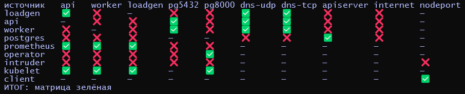

Что важно на скриншоте:
- **`intruder` → всё ❌**, включая `postgres`:5432 — главное требование задания. И даже **NodePort ❌**: с `Local` трафик пода на NodePort идёт без SNAT, политика видит IP intruder и не пускает. Та самая «отмывка» через NodePort не работает;
- `api` и `worker` → `postgres`:5432 ✅;
- `postgres → apiserver` ✅ (CNP), все остальные → apiserver ❌;
- оператор CNPG → 8000 ✅, → 5432 ❌;
- kubelet ✅ без отдельных правил;
- ни одного `REFUSED` — нет правил шире, чем нужно.

После фикса `shop-db` healthy, loadgen 0 ошибок, поды без рестартов.

## Часть 6 — Скрытая поломка

### break.sh

Скрипт: [`break.sh`](./break.sh). Случайно выбирает один вариант из четырёх и применяет через `helm upgrade --reset-values --set`:

| | Класс | Как ломает |
|---|---|---|
| A | неверные лейблы в allow-правиле | `database.podLabels.cnpg.io/cluster=shop-database` — селектор БД не выбирает ни одного пода |
| B | порт в правиле ≠ порт сервиса | `database.port=5433` |
| C | нет разрешения на DNS для клиента | `dns.clients={api,worker}` — loadgen без DNS |
| D | неверный порт DNS | `dns.port=5353` |

### Прогон 1

Поломка внесена в 15:02:47 MSK. Loadgen начал сыпать ошибками.

Первым делом открыл Hubble UI — и почти ничего не увидел:

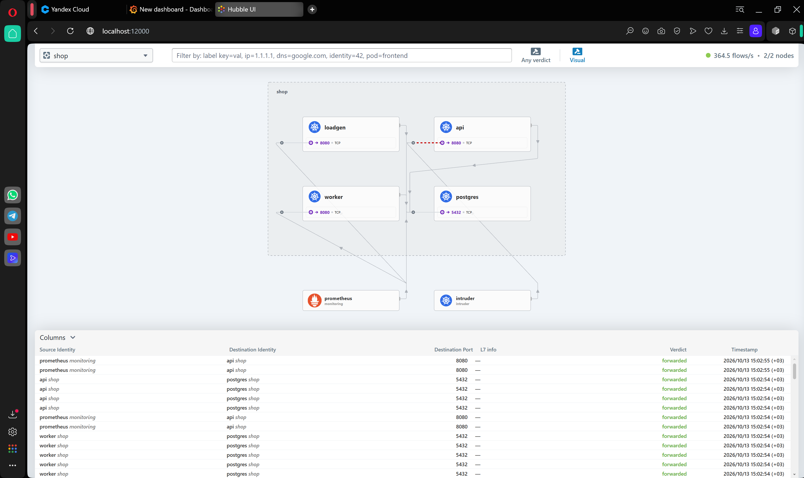

Единственная красная линия — `intruder → api`, и это правильный ❌ (тот самый посторонний под из Части 5). Зелёные `api/worker → postgres:5432` в таблице — это старые поды по ещё открытым соединениям.

Оказалось, Hubble UI **по умолчанию скрывает kube-dns** (Visual → Hide kube-dns:53 pod). А поломка была как раз там. 

```bash
hubble observe -n shop --verdict DROPPED --follow -o compact
```

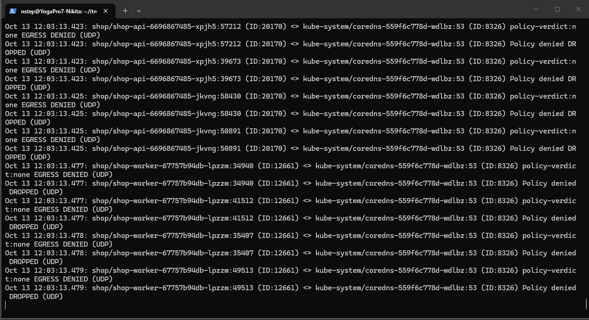

### Путь диагностики

**1. Что дропается.** Все дропы одинаковые: `EGRESS DENIED (UDP)` на `kube-system/coredns:53`, `policy-verdict:none`. То есть исходящий DNS не разрешило ни одно правило — сработал default-deny.

**2. Кто задет.** Посчитал дропы по источникам: `api` 1540, `worker` 688, `loadgen` 92. Задеты **все** DNS-клиенты. 
Почему у loadgen дропов меньше всех, хотя он самый активный? Он висит на DNS до таймаута 2 с, упирается в `MAX_INFLIGHT` и сам себя троттлит.

**3. Сверка политики.** У allow-правила три части, и каждую можно сверить с реальностью:

```bash
kubectl -n shop get networkpolicy shop-allow-dns -o yaml
kubectl -n kube-system get svc kube-dns
```

| Часть | В политике | В реальности | |
|---|---|---|---|
| `podSelector` (кто) | `api`, `worker`, `loadgen` | метки подов совпадают | ✅ |
| `to` (куда) | ns `kube-system`, `k8s-app=kube-dns` | метки CoreDNS совпадают | ✅ |
| `ports` | **5353** UDP/TCP | Service `kube-dns`: `53 → 53` | ❌ |

**4. Гипотеза:** 

DNS разрешён на 5353, а CoreDNS слушает 53.

**5. Починка:** `helm upgrade shop ./chart/shop -n shop --reset-values --wait` (revision 48, 15:06:01 MSK). Первая проверка показала «585 failed за 30 секунд» и меня напугала, но это окно захватило время до починки. Через минуту — 0 ошибок, последняя ошибка в 15:06:04. Матрица снова **зелёная**.


<!-- мем: Чарли Дэй у стены с красными нитками (Pepe Silvia, "It's Always Sunny in Philadelphia"), подпись "когда пытаешься объяснить, почему отсутствие красной линии на карте Hubble — это и есть улика" -->

### Прогон 2 — красная линия в UI

Для скриншота с картой запустил `break.sh` ещё раз. Рандом снова выбрал **D** (15:10 MSK) — видимо, ему понравилось. На этот раз с выключенным «Hide kube-dns»:

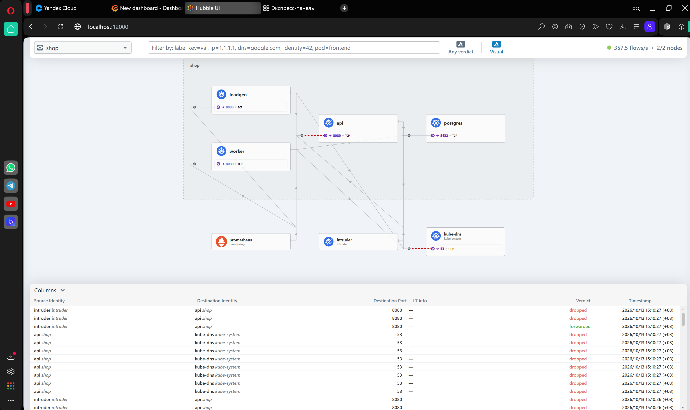

Красная пунктирная линия к `kube-dns` на `53 UDP`, в таблице — `api → kube-dns:53 dropped`.

Там же есть строка `intruder → api forwarded`. Сначала напрягся, но нет: это наблюдение на **выходе** из intruder (в namespace `intruder` политик нет, выпускать можно). На **входе** в `api` тот же поток — `dropped`.

## Часть 7 — Мониторинг

### Источники метрик

В [`install/cilium-values.yaml`](./install/cilium-values.yaml) добавил:

```yaml
prometheus:
  enabled: true        # агент Cilium на :9962 — дропы, CT map, ...
hubble:
  metrics:
    enabled:
      - "drop:labelsContext=source_namespace,source_workload,destination_namespace,destination_workload,traffic_direction"
      - "tcp:labelsContext=source_namespace,source_workload,destination_namespace,destination_workload"
      - "flow:labelsContext=source_namespace,destination_namespace"
```

В метках **нет** pod и IP. Иначе каждый новый под плодил бы новые временные ряды. `workload` = имя Deployment, оно стабильно.

DNS-метрики Hubble без L7 DNS-прокси пустые, так что DNS берём из CoreDNS (kps его уже скрейпит), а дропы на :53 — из Hubble.

В чарт:
- [`cilium-monitors.yaml`](./chart/shop/templates/cilium-monitors.yaml) — **PodMonitor** для агента (у агента порт есть, а Service — нет) и **ServiceMonitor** для `hubble-metrics`;
- [`prometheusrule-network.yaml`](./chart/shop/templates/prometheusrule-network.yaml) — 3 алерта;
- [`dashboard-network.yaml`](./chart/shop/templates/dashboard-network.yaml) + [`dashboards/network.json`](./chart/shop/dashboards/network.json) — дашборд.

### Дашборд «shop: сеть и политики»

| Панель | Что показывает |
|---|---|
| Клиент: заказы в секунду | ok / ошибки loadgen |
| Новые TCP-соединения из shop (SYN/с) | рёбра по источник → назначение |
| Отклонено политикой | дропы на вход и выход по рёбрам |
| DNS | ответы CoreDNS по rcode + DNS-запросы, срезанные политикой |
| Заполненность CT map Cilium | таблица из Части 2 |

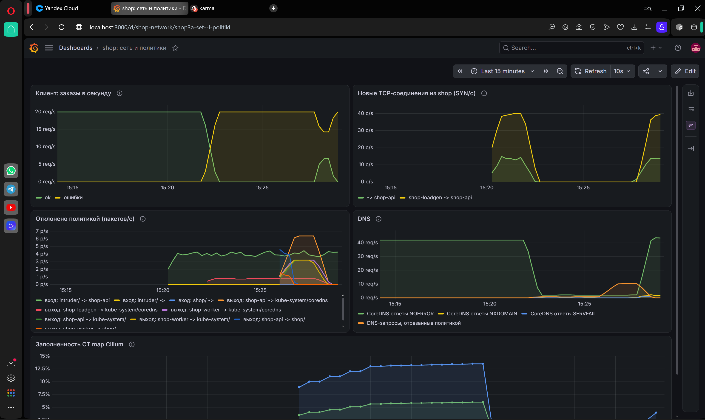

На скриншоте — момент провокации. ok падает в ноль, линия ошибок поднимается до 20. В панели DNS ответы NOERROR проваливаются с ~40 до нуля, и растёт линия «DNS-запросы, отрезанные политикой». В дропах появляются `shop-api → kube-system/coredns`, `shop-worker → kube-system/coredns`. Постоянная зелёная линия ~4 p/s — это `intruder → shop-api`, тот самый посторонний под, его дропы идут фоном всю дорогу. Около 15:27 починил, ok вернулся.

### Алерты

**1. `ShopEgressDeniedByPolicy`** (critical) — исходящие из `shop` пакеты режутся политикой, кроме DNS. Исходящий дроп из своего пода — это всегдал ибо сломана allow-политика (наш под хочет туда, куда ему надо, а его не пускают), либо под делает то, чего делать не должен (стучится туда, куда не должен). Оба случая требуют человека.

**2. `ShopDNSBlocked`** (critical) — DNS-запросы из `shop` режутся политикой. Отдельный алерт, потому что поломка DNS ломает **всё и сразу**. И у неё конкретный runbook: смотреть `shop-allow-dns` — `dns.clients`, метки kube-dns, порт 53. Именно так я искал причину в Части 6, только руками.

**3. `CiliumConntrackMapPressure`** (warning) — CT map заполнена больше чем на 80%. Это инцидент из Части 2, только пойманный заранее. При 100% Cilium молча дропает новые потоки, и снаружи это выглядит как «случайные таймауты».

### Провокация

```bash
helm upgrade shop ./chart/shop -n shop --reuse-values \
  --set networkPolicy.dns.port=5353 \
  --set networkPolicy.database.port=5433 \
  --set monitoring.networkAlerts.ctMapPressureThreshold=0.05
kubectl -n shop rollout restart deploy/shop-api deploy/shop-worker
```

Сломал сразу DNS и порт БД. Заодно опустил порог CT map до 5%, надеясь проверить и третье правило — но `CiliumConntrackMapPressure` поймать так и не получилось: реального переполнения после фикса в Части 2 на площадке больше нет, а с заниженным порогом алерт в Karma так и не появился. Так что третий алерт остаётся описанным на бумаге — его «боевое» срабатывание по сути, было видно в Части 2, только тогда алерта ещё не было 🙃

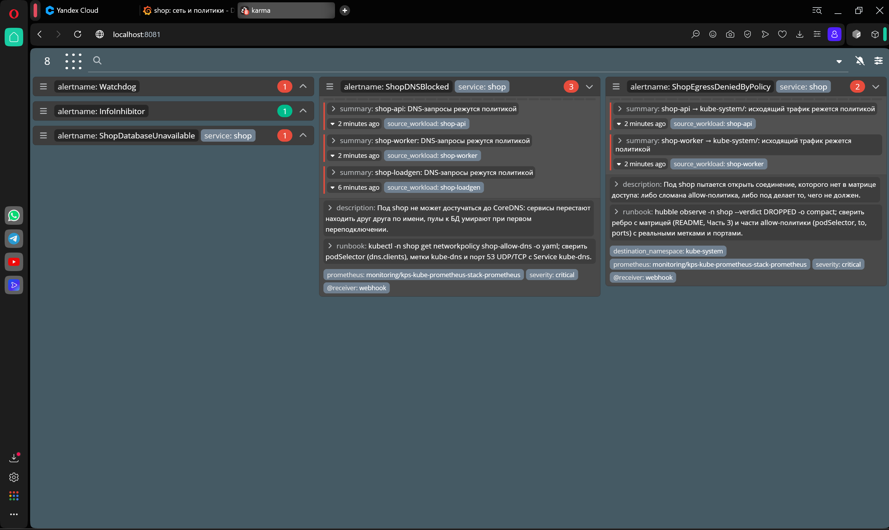

- `ShopDNSBlocked` × 3 — `shop-api`, `shop-worker`, `shop-loadgen`
- `ShopEgressDeniedByPolicy` × 2 — `shop-api` и `shop-worker`

## Вывод

Что получилось:
- kindnet заменён на Cilium без пересоздания кластера, все поды переехали под его управление
- разобрал, как под получает сеть: `/32`, шлюз `cilium_host`, veth-пара `eth0@if42` ↔ `lxc…@if41`, BPF-таблица эндпоинтов вместо маршрутов, identity по меткам
- **59 убитых подов за 10 минут — 12 000 запросов, 0 ошибок** у клиента, который ходит по DNS-имени
- матрица доступа спроектирована по реальному трафику из Hubble, реализована 6 NetworkPolicy + 1 CiliumNetworkPolicy, все значения в `values.yaml`
- посторонний под не достаёт ни до PostgreSQL, ни даже до NodePort

Главные уроки:
- **молчаливый дроп хуже отказа.** Cilium не говорит `connection refused`, он просто не отвечает. Без Hubble default-deny выглядит как «всё зависло»
- **DNS ломается первым и прячется лучше всех.** Его скрывает Hubble UI и его не видно за долгоживущими пулами.
- **строка матрицы — это инициатор.** Ответы проходят по conntrack, разрешать их отдельно не надо
- **у Cilium свои таблицы — и они конечны.** CT map переполнилась ещё до всякого хаоса, и это было самой сложной находкой лабы
- **kube-proxy делает меньше, чем кажется.** С Cilium трафик под → ClusterIP балансируется в eBPF, а iptables kube-proxy обслуживает в основном NodePort
