# Лаба 6 — Автопилот релиза: катит хорошее, откатывает плохое

Задание: https://github.com/KeladKaal/containerization-and-orchestration/blob/main-rus/lecture-6-service-mesh/lab.md

## Предисловие

В Лабе 5 я наконец разобрался, как пакет доходит от пода до пода. Ну и, конечно, сразу же в этой лабе поверх этой сети надо положить ещё одну — service mesh 🙃

Задача в этот раз такая: поставить mesh вокруг `api`, получить от него mTLS и ретраи "бесплатно", а потом написать автопилот, который сам выкатывает новую версию канарейкой. Хорошую — докатывает до 100%, плохую — откатывает, и всё это без человека. А в конце честно посчитать, сколько этот mesh стоит, и решить, нужен ли он вообще.

> "Ну тут же всё готовое: ставишь Linkerd, пишешь `HTTPRoute` с весами, и готово" — подумал я.

Готово было примерно с третьей версии гейта. Но об этом в Части 7.

<!-- мем: Xzibit "Yo dawg" — подпись "Слышал, ты любишь сети, поэтому мы положили сеть поверх твоей сети" -->

Площадка та же, что в Лабе 5: minikube из 2 нод (docker driver, containerd), CNI — Cilium, мониторинг — kube-prometheus-stack из Лабы 2, гвардрейлы — Kyverno из Лабы 3.

Чарт скопирован из Лабы 5 в [`./chart/shop`](./chart/shop) (версия `0.6.0`). Всё, что было в прошлых лабах (NetworkPolicy, PDB, PriorityClass, алерты), осталось на месте.

## Часть 0 — Сервисы

Снова Go, снова те же сервисы, но с доработками:

| Что | Где | Что добавлено |
|---|---|---|
| `api` | [`api/`](./api) | версия `v1`/`v2` зашивается при сборке (`--build-arg VERSION`), `GET /version`; `FAIL=true` — `POST /order` всегда 500; `FLAKY=true` — `POST /order` падает 503 с вероятностью `FLAKY_RATE`; заголовок `X-Api-Version` |
| `loadgen` | [`loadgen/`](./loadgen) | клиент `api` (20 RPS `POST /order`): мелкие корзины гистограммы, счётчик ответов по версиям, `GET /probe?n=N` для проверки деления трафика |
| `gate` | [`gate/`](./gate) | гейт канареечного релиза (Часть 6) |

Один код — два образа, отличаются только версией:

```bash
minikube image build --all -t registry.local/shop/api:v1 --build-opt="opt=build-arg:VERSION=v1" api
minikube image build --all -t registry.local/shop/api:v2 --build-opt="opt=build-arg:VERSION=v2" api
minikube image build --all -t registry.local/shop/loadgen:0.2.0 loadgen
minikube image build --all -t registry.local/shop/gate:0.1.0 gate
```

Уже тут поймал первые грабли: `--build-opt=build-arg=...`, как у docker, не работает. У buildctl свой синтаксис — `opt=build-arg:KEY=VAL`.

## Часть 1 — Выбор mesh

Выбирал между **Linkerd** и **Istio ambient**. Выбор пал на **Linkerd** (edge-26.10.1):

| | Linkerd | Istio ambient |
|---|---|---|
| Где живёт прокси | sidecar `linkerd-proxy` (Rust) в каждом поде | `ztunnel` (DaemonSet) на ноде — L4 и mTLS; L7 (ретраи, split) — отдельный `waypoint` на Envoy |
| Что нужно для этой лабы | control plane из 3 подов, аннотация `linkerd.io/inject` на поды | istiod + ztunnel + istio-cni + waypoint для ns `shop` |
| Совместимость с Cilium из Лабы 5 | работает из коробки, `proxy-init` настраивает iptables внутри пода | нужно перенастраивать Cilium (`cni.exclusive=false`, socket LB только в host ns) — то есть ломать рабочий CNI |
| Traffic split | Gateway API `HTTPRoute` с `weight` — стандартный объект | тот же `HTTPRoute`, но только через waypoint |
| Метрики | прокси сам отдаёт `response_total`, `response_latency_ms`, метрики ретраев по маршруту | метрики Envoy/ztunnel, богаче, но тяжелее |
| Память | прокси ~10–20 MiB, control plane ~150 MiB | istiod ~200+ MiB, ztunnel на каждой ноде, waypoint |

Решающими стали три вещи:
- **ноутбук на 7 GiB уже наполовину занят** стеком мониторинга. Linkerd тут самый лёгкий
- **не трогать CNI.** Cilium из Лабы 5 работает, NetworkPolicy в чарте завязаны на него. После всех приключений с CT map ломать его ради ambient не хотелось совсем
- **mesh только вокруг `api`.** Sidecar-модель как раз про это: в mesh попадают только поды с аннотацией (`api` и его клиент `loadgen`), а не весь namespace или нода

Минус sidecar-модели тоже понятен: прокси в каждом поде — это CPU и память на каждый под, а не на ноду. Его и считаю в Части 8.

### Установка

```bash
# Gateway API CRDs: edge-ветка Linkerd их больше не ставит, linkerd check --pre без них падает
kubectl apply --server-side -f https://github.com/kubernetes-sigs/gateway-api/releases/download/v1.5.1/standard-install.yaml

curl --proto '=https' -sSfL https://run.linkerd.io/install-edge | sh
linkerd install --crds | kubectl apply -f -
linkerd install | kubectl apply -f -
linkerd check
```

> Стабильные сборки Linkerd теперь раздаёт только Buoyant, open source — это edge-релизы.

### Что поймал: Kyverno против sidecar

<!-- мем: Гэндальф "You shall not pass!" — Гэндальф подписан Kyverno, Балрог — linkerd-proxy -->

Гвардрейлы Лабы 3 в режиме `Deny` сделали ровно то, для чего их писали — не пустили Linkerd:
- control plane в ns `linkerd`: образы `cr.l5d.io`, нет меток `part-of` и `limits`
- sidecar в подах `shop`: Kyverno проверяет под **после** мутации инжектором и видит чужой образ `cr.l5d.io/linkerd/proxy`

Политики скопировал в [`policies/`](./policies) и поправил:
- `linkerd` добавлен в исключённые namespace (как `monitoring` и `cnpg-system`)
- `cr.l5d.io/linkerd/` — в доверенные реестры
- ресурсы sidecar задаются аннотациями `config.linkerd.io/proxy-*` в `values.yaml`, и инжектор ставит те же значения на `proxy-init`. Так что `require-resource-limits` выполняется без исключений
- `proxy-init` хоть и просит `NET_ADMIN`/`NET_RAW`, но с `allowPrivilegeEscalation: false` и `privileged: false`, поэтому `disallow-privileged-containers` его пропускает

Проверял всё это до выкатки, server-side dry-run'ом инжектированного Deployment (урок Лабы 2 про `helm lint` ≠ рабочий манифест не прошёл даром):

```bash
helm template shop chart/shop -n shop --set mesh.enabled=true -s templates/api-deployment.yaml \
  | linkerd inject --manual - | kubectl apply --dry-run=server -n shop -f -
```

## Часть 2 — Baseline без mesh

Прежде чем что-то мерить с mesh, надо знать, с чем сравнивать. Что поменялось в чарте под эту лабу (всё — правки копии чарта Лабы 5, старое осталось):

| Было (Лаба 5) | Стало |
|---|---|
| `api.tag`, `api.replicas` | `api.versions.{v1,v2}`: у каждой версии свой Deployment `shop-api-<v>`, метка `version`, образ, `fail`/`flaky` |
| Service `shop-api` | он же, селектор без версии (видит обе), плюс `shop-api-v1` / `shop-api-v2` — бэкенды для traffic split |
| — | своя ServiceAccount `shop-api` и `shop-loadgen`: в mesh identity пода = имя его SA |
| ServiceMonitor на `api, worker, batch, loadgen` | + `gate`, и `version DoesNotExist` — иначе поды api скрейпились бы дважды, через `shop-api` и через `shop-api-v1` |

```bash
helm upgrade shop chart/shop -n shop --reset-values --wait \
  --set mesh.enabled=false --set api.versions.v2.enabled=false --set gate.enabled=false    # v1 x2, без mesh
```

Нагрузка — `loadgen` из Лабы 5: 20 RPS `POST /order` без keep-alive. Корзины гистограммы у него стали мельче (от 1 мс): старые 5/10/25 мс не увидели бы разницу в единицы миллисекунд, которую добавляет прокси.

Замерял небольшим скриптом поверх Prometheus: задержка глазами клиента (гистограмма `loadgen`) и CPU/память контейнеров подов `api` из cAdvisor, окно 5 минут на стабильной нагрузке. `kubectl top` тут не помощник — metrics-server в кластере нет.

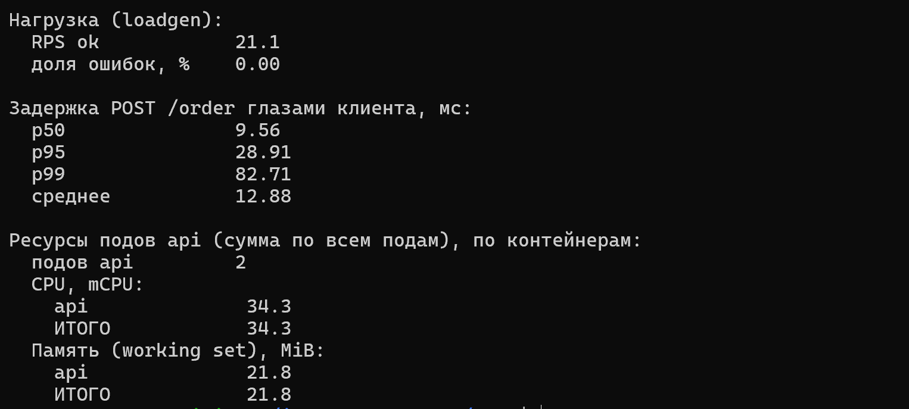

| Метрика | Baseline (без mesh) |
|---|---|
| RPS | 21.1, ошибок 0% |
| p50 / p95 / p99 | 9.56 / 28.91 / 82.71 мс |
| среднее | 12.88 мс |
| CPU `api` (2 пода) | 34.3 mCPU |
| память `api` (2 пода) | 21.8 MiB |

## Часть 3 — Mesh и mTLS

Mesh включается одним флагом `mesh.enabled`, всё остальное — значения чарта:

```yaml
mesh:
  enabled: true
  podAnnotations:
    linkerd.io/inject: enabled
    config.linkerd.io/proxy-cpu-request: 20m
    config.linkerd.io/proxy-memory-request: 32Mi
    config.linkerd.io/proxy-memory-limit: 64Mi
```

Аннотации ставятся на поды `api` (обе версии) и `loadgen`. `loadgen` в mesh обязательно: в Linkerd traffic split и ретраи делает прокси **клиента**, без клиента в mesh не будет ни того, ни другого. `worker` и `postgres` остаются вне mesh, как и просили.

Zero-trust из Лабы 5 не выключал — не для того я его так долго закручивал. NetworkPolicy аддитивны, поэтому добавил отдельную [`networkpolicy-mesh.yaml`](./chart/shop/templates/networkpolicy-mesh.yaml) с рёбрами, которые нужны прокси:
- доступ к control plane в ns `linkerd`
- inbound-порт прокси `4143` между подами в mesh
- `4191` (метрики прокси) для Prometheus

```bash
helm upgrade shop chart/shop -n shop --reset-values --wait \
  --set api.versions.v2.enabled=false --set gate.enabled=false
linkerd check --proxy -n shop      # всё √
```

Ещё одни грабли по дороге: ключ `on:` в values для `retry.linkerd.io/http`. YAML 1.1 читает `on` как `true`, и аннотация рендерилась пустой. Переименовал в `statuses`. Снова что-то сломалось **молча**.

### Доказательство

Сначала хотел снять tcpdump "до/после", но сниффер требует root, а поды `shop` работают от UID 65532 под политикой Лабы 3. Отходить от nonroot ради скриншота не стал. Тем более Linkerd сам даёт криптографические доказательства — достаточно вытащить сертификат прокси и его метрики:

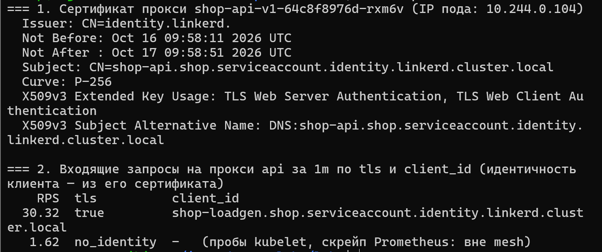

1. **Сертификат прокси пода `api`** (`linkerd identity`): Subject и SAN — `shop-api.shop.serviceaccount.identity.linkerd.cluster.local`. Это имя ServiceAccount, IP пода в сертификате нет вообще. Выдан CA Linkerd (`identity.linkerd`), живёт 24 часа (ротируется сам), ключ ECDSA P-256, EKU — и `Server`, и `Client Authentication`. Один и тот же сертификат прокси предъявляет и как сервер, и как клиент. Это и есть mutual TLS
2. **Метрики inbound-прокси `api`**: все запросы `loadgen` приходят с `tls="true"` и `client_id="shop-loadgen.shop.serviceaccount.identity.linkerd.cluster.local"`. Серверный прокси проверил сертификат клиента и знает его по имени из сертификата, а не по IP. А пробы kubelet и скрейп Prometheus, которые не в mesh, приходят как `tls="no_identity"`: шифрование только там, где обе стороны в mesh

> На снимке ~30 RPS вместо 21: он сделан, когда уже был включён FLAKY из Части 4, и к запросам добавились ретраи.

### Находка: дыра в гвардрейлах Лабы 3

Пока прикидывал вариант с tcpdump, заметил, что `kubectl debug` с root-контейнером прошёл мимо Kyverno. Политики матчат ресурс `pods`, а ephemeral-контейнеры добавляются через subresource `pods/ephemeralcontainers`. Так что "nonroot везде" в Лабе 3 было не совсем везде 🫠

<!-- мем: Охранник спит на посту, а мимо проходит человек — охранник "Kyverno", проходящий "kubectl debug с root" -->

## Часть 4 — Надёжность бесплатно

Ретраи настроены аннотациями на `HTTPRoute` (значения `mesh.retries`):

```yaml
retry.linkerd.io/http: "5xx"      # на какие ответы
retry.linkerd.io/limit: "3"       # до 3 повторов
retry.linkerd.io/timeout: "1s"    # таймаут одной попытки
```

Включаем `FLAKY=true`: `POST /order` с вероятностью 30% отвечает 503 (до записи в БД).

```bash
helm upgrade shop chart/shop -n shop --reset-values --wait \
  --set api.versions.v2.enabled=false --set gate.enabled=false --set api.versions.v1.flaky=true
```

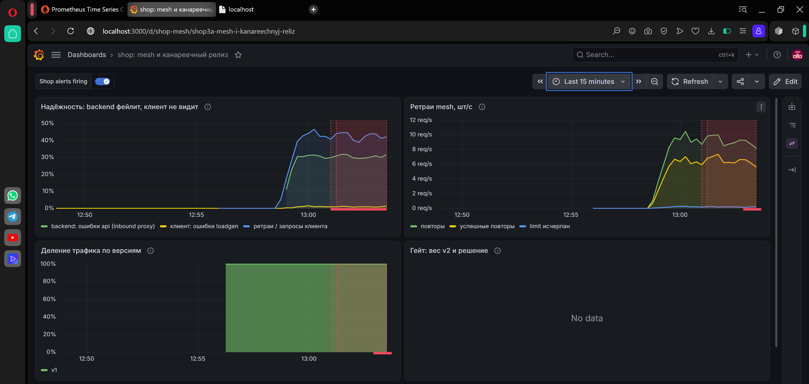

| Что | Значение | Откуда |
|---|---|---|
| backend отвечает ошибкой | **28.9%** | `response_total{direction="inbound", classification="failure"}` прокси `api` |
| клиент видит ошибку | **0.84%** | `loadgen_requests_total{result!="ok"}` |
| ретраи / запросы клиента | ~40% | `outbound_http_route_retry_requests_total` прокси `loadgen` |
| ретраи упёрлись в limit | 0.19/с (~0.9% запросов) | `outbound_http_route_retry_limit_exceeded_total` |

Backend сыплет ошибками на каждый третий запрос, а клиент этого почти не замечает.

<!-- мем: Собака в горящей комнате "This is fine" — собака подписана "клиент: 0.84% ошибок", огонь — "backend: 28.9% ошибок" -->

### Какой механизм сработал — ретраи

Определял по метрикам самого mesh:
- **ретраи есть.** `outbound_http_route_retry_requests_total` в прокси клиента ~8.5/с при 21 RPS, и большая их часть — `retry_successes`
- **цифры совпадают с чистыми ретраями.** Попыток 4 (1 + limit 3), каждая падает независимо с p=0.3. До клиента ошибка доходит, только если упали все: 0.3⁴ = **0.81%**, у клиента — **0.84%**. Повторов на запрос в среднем 0.3 + 0.3² + 0.3³ ≈ 0.42, на графике ~40%. Теорвер сошёлся с практикой, приятно 😄
- **circuit breaking не участвовал.** `outbound_http_balancer_endpoints{backend_name="shop-api-v1"}` — оба пода всё время `ready`, `pending` за весь период 0 (`max_over_time`). Failure accrual (`balancer.linkerd.io/failure-accrual` на Service) я не включал, и он бы здесь не помог: оба пода v1 флакают одинаково, выбрасывать из балансировки некого. Circuit breaking лечит "один плохой под", а у нас "плохой каждый запрос с вероятностью 30%"

Красная зона на графике — сработавший `ShopApiVersionHighErrorRate` (Часть 9): клиент ошибок почти не видит, но backend реально сыплет 503, и об этом надо знать.

### Что поймал: ретраи не бесплатны

Первая версия была с `retry.linkerd.io/timeout: 300ms`, и в метриках бэкенда появился `error="RESPONSE_HEADERS_TIMEOUT"`. Прокси обрывал медленную попытку и повторял `POST /order`, а первая попытка могла уже записать заказ. Привет, дубль.

<!-- мем: Человек-паук показывает на Человека-паука — оба подписаны "заказ #42" -->

Поднял таймаут до `1s` (~12x baseline p99). Сбои `FLAKY`/`FAIL` в коде стоят **до** записи в БД, так что ретраи на них безопасны. Но в реальной системе ретраить неидемпотентный `POST` можно только с ключом идемпотентности.

## Часть 5 — v1/v2 и traffic split

Traffic split — объект mesh в чарте: [`mesh-httproute.yaml`](./chart/shop/templates/mesh-httproute.yaml), Gateway API `HTTPRoute`. `parentRef` — Service `shop-api`, на который ходят клиенты. Прокси клиента, увидев этот маршрут, раскладывает запросы по `backendRefs` пропорционально `weight`:

```yaml
spec:
  parentRefs:
    - {group: "", kind: Service, name: shop-api, port: 8080}
  rules:
    - backendRefs:
        - {name: shop-api-v1, port: 8080, weight: 90}
        - {name: shop-api-v2, port: 8080, weight: 10}
```

```bash
helm upgrade shop chart/shop -n shop --reset-values --wait --set gate.enabled=false   # веса из canary.weights: 90/10
```

Проверка — `GET /probe?n=1000` у `loadgen`: он делает 1000 запросов `GET /version` к `shop-api` изнутри своего пода, то есть через свой прокси, где и работает split:

```
v1   891  89.1%
v2   109  10.9%
```

Повторный прогон дал 90.5% / 9.5%. Разброс ±1.5% на 1000 запросах при случайном выборе бэкенда — норма.

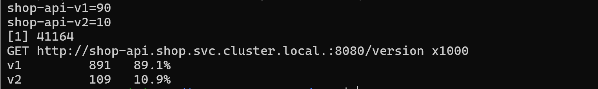

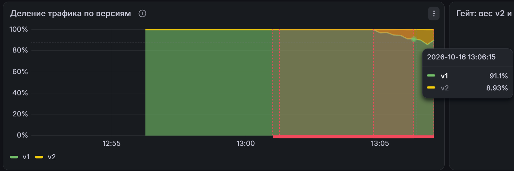

Самое интересное: вес не зависит от числа подов. У v1 2 пода, у v2 — 1, а делится всё равно 90/10. Без mesh kube-proxy (ну или Cilium, как выяснилось в Лабе 5) делил бы по подам, 2:1.

Ещё попробовал для контраста сходить снаружи mesh через NodePort — получил 300 из 300 на v1. Но это не "без mesh делит иначе", а `externalTrafficPolicy: Local` из Лабы 5: на ноде `minikube` просто нет пода v2. Нечестное сравнение, так что в выводы не пошло.

## Часть 6 — Автопилот

Гейт — [`gate/main.go`](./gate/main.go), Deployment в чарте ([`gate.yaml`](./chart/shop/templates/gate.yaml)), правила — в `values.gate`.

### На что смотрит

Раз в **15 секунд** три запроса в Prometheus. Все — по метрикам **inbound-прокси Linkerd на подах v2**, окно `rate()` 1 минута, только mTLS-трафик (`tls="true"`, без проб kubelet и скрейпов):

| Что | Запрос | Порог |
|---|---|---|
| трафик на v2 | `sum(rate(response_total{version="v2", direction="inbound", tls="true"}[1m]))` | ≥ 0.5 RPS, иначе судить не по чему |
| доля ошибок v2 | `... classification="failure" / ...` всех ответов | ≤ 5% |
| задержка v2 | `histogram_quantile(0.95, ... response_latency_ms_bucket ...)` | p95 ≤ 300 мс |

Почему именно inbound v2, а не ошибки клиента — станет понятно в сценарии 1: ретраи прячут ошибки от клиента.

### Как решает

```
         старт (каждый новый релиз v2 = рестарт гейта)
                         │ вес v2 = 10%
                         ▼
     ┌──────────── проверка раз в 15 с ─────────────────────┐
     │ RPS v2 < 0.5                   → ждать               │
     │ от старта релиза < 30 с + 1 мин → ждать              │  (в окне — поды прошлого релиза)
     │ ошибки > 5% или p95 > 300 мс   → ОТКАТ: v2 = 0%, стоп│
     │ от последней смены веса < 1 мин → ждать              │  (прогрев шага)
     │ иначе здорова; 2 раза подряд   → следующий шаг       │
     └──────────────────────────────────────────────────────┘
         шаги: 10 → 25 → 50 → 75 → 100%;  на 100% — стоп, релиз докачен
```

- **откат — сразу**, по первой плохой проверке, и навсегда (до нового релиза). Лучше зря откатить хорошую версию, чем пустить пользователей на плохую
- **повышение — медленно**: нужны две здоровые проверки подряд, и только после **прогрева**. Прогрев = окну `rate()`: пока в окне есть данные до смены веса, повышать по ним нельзя
- **на старте релиза — никаких решений** 1.5 минуты (30 с на выкатку нового пода v2 + окно). В окне ещё лежат ответы подов прошлого релиза v2, и судить по ним — значит судить не ту версию. Как я до этого дошёл — в Части 7
- **мало трафика — не решение.** На 10% при 20 RPS v2 получает 2 RPS, а сразу после старта и того меньше. Без порога на RPS гейт мог бы откатить или повысить по 1–2 запросам

Веса меняются JSON Patch'ем `HTTPRoute` через API Kubernetes. У гейта своя ServiceAccount с Role только на `get`/`patch` одного HTTPRoute `shop-api` — лишних прав автопилоту не нужно. Операции `test` в патче проверяют, что `backendRefs/0` — это `shop-api-v1`, а `/1` — `shop-api-v2`, чтобы не перепутать бэкенды, если кто-то поменяет порядок в чарте.

Новый релиз = рестарт гейта: в аннотации пода гейта лежит checksum значений `api.versions.v2` и `gate`. Поменял образ v2 или `FAIL` — Deployment гейта пересоздаётся (`strategy: Recreate`, двух гейтов одновременно не бывает) и начинает с 10%.

Свои метрики гейт отдаёт в `/metrics`: `gate_v2_weight`, `gate_state` (0 — едет, 1 — докатил, 2 — откатил), `gate_v2_error_rate`, `gate_decisions_total`. Их и рисует дашборд.

## Часть 7 — Оба сценария

### 1. Плохой релиз: `FAIL=true`

```bash
helm upgrade shop chart/shop -n shop --reset-values --wait --set api.versions.v2.fail=true
```

```
10:25:18 gate: start, v2=10% ... warmup=1m0s, start_delay=30s
10:25:32 v2=10%: release warming up 15s/1m30s, old v2 pods may still be in the window (error_rate=0.000, rps=18.9)
10:25:47 v2=10%: release warming up 30s/1m30s ... (error_rate=0.071)
10:25:59 v2=10%: release warming up 45s/1m30s ... (error_rate=0.198)
10:26:14 v2=10%: release warming up 1m0s/1m30s ... (error_rate=1.000)
10:26:27 v2=10%: release warming up 1m15s/1m30s ... (error_rate=1.000)
10:26:42 ROLLBACK: v2 10% -> 0%: error_rate=1.000 (max 0.050), p95=2ms (max 300)
```

Через 84 секунды после старта гейт сам вернул всё на v1. HTTPRoute после: `v1=100, v2=0`.

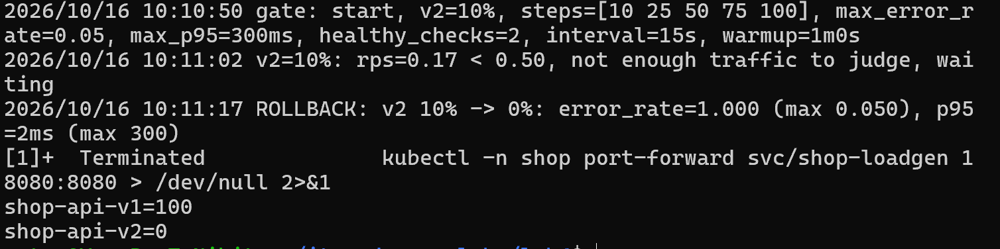

На снимке — прогон на версии гейта 0.1.1 (откат за 27 секунд, без стартового прогрева), лог финальной версии 0.1.2 — выше.

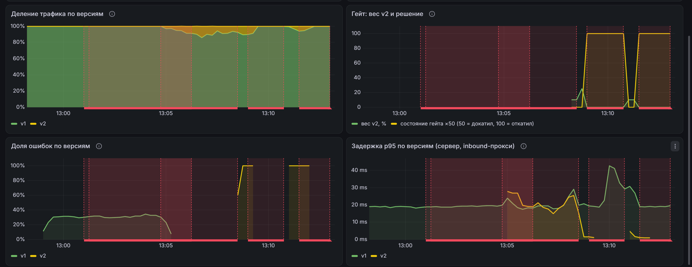

По логу видно, как в окне `rate()` сменяются поды: на 15-й секунде `error_rate=0` — это ещё ответы **старого здорового** пода v2, потом 7%, 20% и, наконец, 100%, когда в окне остался только новый под с `FAIL=true`.

А что видел клиент? **Ни одной ошибки.** v2 вернула десятки ответов 500, но ретраи из Части 4 повторили их все (в первом прогоне: 68 повторов, 67 успешных). Повтор снова проходит через маршрут и почти всегда попадает в v1.

<!-- мем: Кот прячется за тонкой ножкой стула / "я невидимка" — кот подписан "v2 с FAIL=true", стул — "ретраи" -->

То есть ретраи спрятали плохой релиз от пользователя. Если бы гейт смотрел на ошибки клиента — он бы ничего не заметил и докатил `FAIL=true` до 100%, где прятать было бы уже некуда. Поэтому гейт и смотрит на inbound-метрики самой v2.

### 2. Хороший релиз: `FAIL=false`

```bash
helm upgrade shop chart/shop -n shop --reset-values --wait      # финальный values.yaml: v2 FAIL=false, гейт включён
```

```
10:17:16 gate: start, v2=10%
10:18:43 v2=10%: healthy 1/2 (error_rate=0.000, p95=20ms, rps=1.9)
10:18:59 PROMOTE: v2 10% -> 25%
10:20:25 PROMOTE: v2 25% -> 50%
10:21:50 PROMOTE: v2 50% -> 75%
10:23:17 PROMOTED: v2 75% -> 100%, release complete
```

За **6 минут** без человека: 10 → 25 → 50 → 75 → 100%, ошибок 0, p95 18–26 мс на каждом шаге. HTTPRoute после: `v1=0, v2=100`.

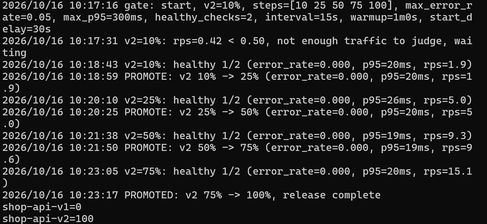

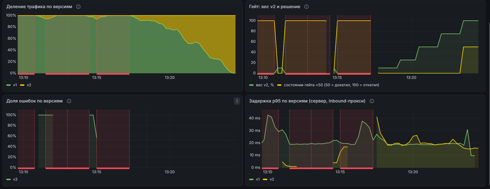

### Что поймал: два бага гейта

Логика из Части 6 — это уже третья версия гейта. Первые две ошибались, причём в противоположные стороны (на графиках сценария 1 в 13:08 и 13:11 видны их следы):

| Версия | Что сделала | Почему |
|---|---|---|
| 0.1.0 | **повысила плохую** v2 до 25%, откатила только на третьей проверке | новый под с `FAIL=true` ещё не набрал двух точек для `rate()`, а окно было заполнено ответами старого здорового пода v2 → `error_rate=0` |
| 0.1.1 (+ прогрев после смены веса, откат — сразу) | **откатила хорошую** v2 через 27 с | теперь наоборот: в окне остались 500-е старого пода с `FAIL=true`, который доживал, пока выкатывался новый |
| 0.1.2 (+ на старте релиза ничего не решать `START_DELAY + WARMUP`) | откат плохой, докат хорошей | решения только по данным текущего релиза |

В 0.1.1 я рассуждал так: "откатывать можно сразу, ошибки же настоящие". Настоящие, да. Но чужие 🤦‍♂️

<!-- мем: Анакин и Падме "ты же исправил гейт, правда? ...правда?" — Анакин "выпустил 0.1.1", Падме "теперь он не откатит хорошую версию, да?" -->

Вывод простой: метрика с окном в 1 минуту помнит прошлое, и гейт, который смотрит на неё сразу после изменения, судит не тот релиз. Цена фикса — плохой релиз теперь полторы минуты получает 10% трафика вместо 27 секунд. Пользователи этого не видят благодаря ретраям, а ошибиться в другую сторону и не откатить плохую версию — хуже.

## Часть 8 — Цена mesh и вердикт

Тот же замер в той же конфигурации, что baseline: 2 пода v1, без v2 и гейта, 21 RPS, окно 5 минут. Только теперь в mesh. Ресурсы — только по подам v1, плюс то, что mesh добавил вне `api`: прокси клиента и control plane.

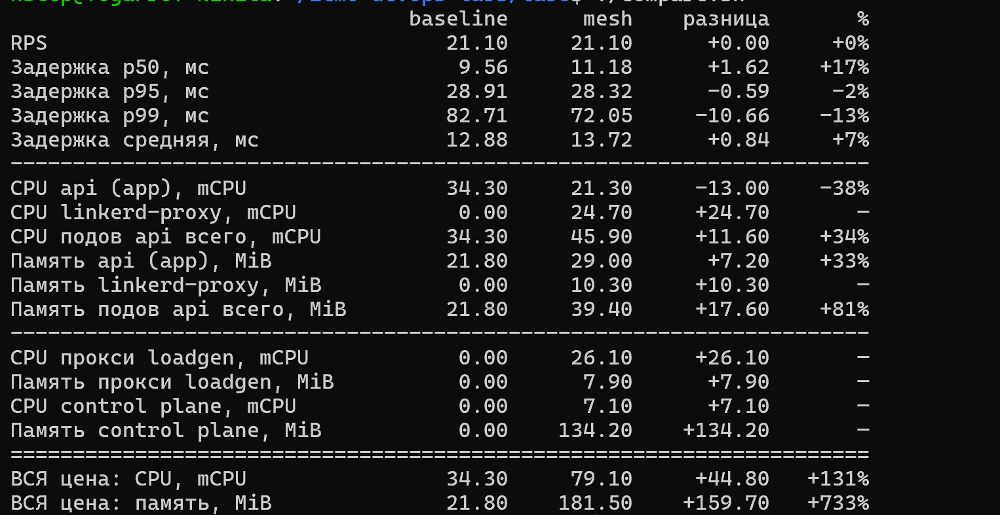

На дашборде — нижние панели: задержка глазами клиента и CPU подов api по контейнерам. `linkerd-proxy` расходует больше самого приложения (на "Доле ошибок" слева сверху — откат плохой v2 гейтом 0.1.2 в 13:26):

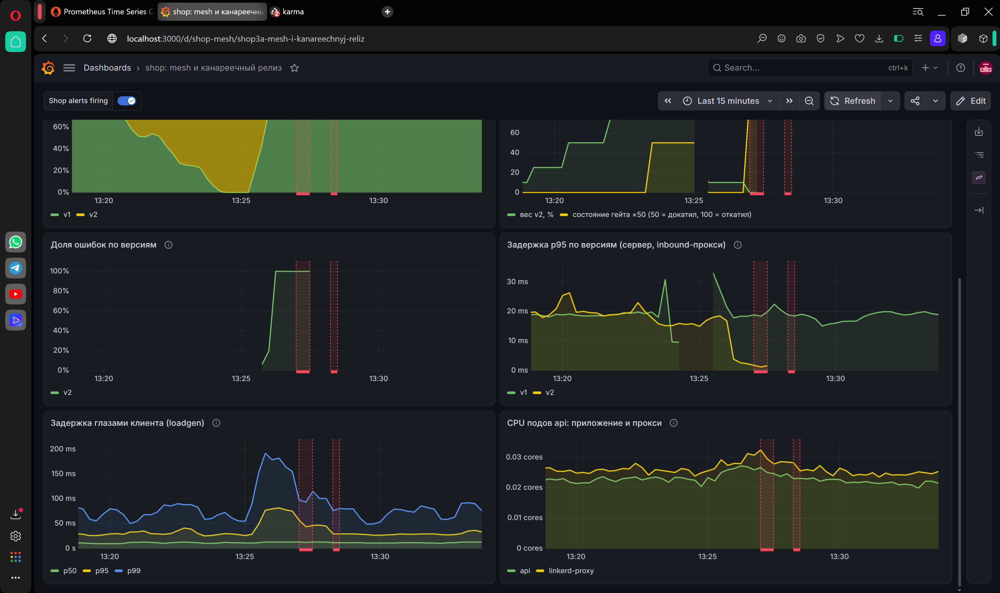

| | baseline | mesh | разница |
|---|---|---|---|
| p50 | 9.56 мс | 11.18 мс | **+1.62 мс (+17%)** |
| p95 | 28.91 мс | 28.32 мс | −0.6 мс (шум) |
| p99 | 82.71 мс | 72.05 мс | −10.7 мс (шум) |
| среднее | 12.88 мс | 13.72 мс | +0.84 мс (+7%) |
| CPU подов `api` (app + proxy) | 34.3 mCPU | 21.3 + 24.7 = 45.9 | **+34%** |
| память подов `api` | 21.8 MiB | 29.0 + 10.3 = 39.4 | **+81%** |
| прокси `loadgen` | — | 26.1 mCPU / 7.9 MiB | |
| control plane `linkerd` | — | 7.1 mCPU / 134.2 MiB | |
| **всё вместе** | 34.3 mCPU / 21.8 MiB | 79.1 mCPU / 181.5 MiB | **+131% CPU, +733% памяти** |

Что видно в цифрах:
- **задержка.** Медиана выросла на 1.6 мс: два лишних прыжка через прокси (клиентский и серверный) и TLS. На p95/p99 разницы нет — хвост определяет `INSERT` в postgres, а он в разы больше накладных расходов прокси
- **CPU самого `api` упал на 38%** (34 → 21 mCPU). `loadgen` открывает новое TCP-соединение на каждый запрос (`KEEPALIVE=false` из Лабы 5). Без mesh это соединение принимал `api`, с mesh — прокси, а между прокси и приложением по localhost живут постоянные соединения. Но прокси эту работу не отменил, а забрал себе, и с запасом: 24.7 mCPU
- **прокси на стороне клиента стоит столько же**, сколько на стороне сервера (26 mCPU) — в sidecar-модели платят обе стороны
- **память съедает control plane**: 134 MiB — это в 6 раз больше, чем весь `api` (22 MiB). Сами прокси лёгкие, 8–10 MiB

Кроме фактического потребления, есть зарезервированное: каждый sidecar просит `20m` CPU и `32Mi` (`requests`), то есть +60m/96Mi на 3 пода. А это, как мы выяснили в Лабе 4, место, которое планировщик уже никому не отдаст.

### Вердикт: для системы такого размера mesh не оправдан

<!-- мем: Огромный корабль на крошечной лодке / "Танк едет за хлебом" — подпись "Linkerd с control plane на 134 MiB ради 2 подов api" -->

Один сервис из двух подов, один клиент, 20 RPS — и за это **+45 mCPU (больше, чем удвоение) и +160 MiB (в 8 раз больше, чем сам `api`)**. Задержка как раз почти бесплатна, дорого всё остальное.

Что mesh дал в этой лабе и сколько бы это стоило без него:

| Что дал mesh | Без mesh |
|---|---|
| mTLS с identity по ServiceAccount | для одного внутреннего клиента в одном кластере за zero-trust NetworkPolicy из Лабы 5 — избыточно; если шифрование обязательно — TLS в самом сервисе или шифрование на уровне CNI (Cilium умеет WireGuard) |
| Ретраи | 10 строк в клиенте (у нас клиент один) |
| Канарейка с весами | два Deployment + веса в ingress/Gateway, или Argo Rollouts |
| Метрики по версиям | у `api` уже есть свои `http_requests_total`, нужна только метка версии |

Каждую возможность по отдельности здесь можно получить дешевле. Mesh начинает окупаться, когда control plane размазывается на много сервисов, а одинаковые mTLS, ретраи и метрики нужны всем сразу без правок кода в каждом: десятки сервисов, разные языки и команды, требование шифровать весь трафик внутри кластера (compliance), частые релизы, которые хочется катить канарейкой. 134 MiB control plane тогда делятся на сотни подов, а не на два.

Для `shop` в его нынешнем виде — нет. Если что-то из этой лабы и оставлять, то гейт: он полезен и без mesh, ему нужны только метрики по версиям и способ менять веса.

## Часть 9 — Мониторинг

Всё в чарте, поверх стека Лабы 2 (Prometheus подхватывает `ServiceMonitor`/`PodMonitor`/`PrometheusRule` без меток `release`):

| Шаблон | Что |
|---|---|
| [`mesh-podmonitor.yaml`](./chart/shop/templates/mesh-podmonitor.yaml) | скрейп всех sidecar'ов релиза (`linkerd-admin` :4191). Прокси ничего не знает о версии — метки `version` и `app` берутся из меток пода через `relabelings` |
| [`servicemonitor.yaml`](./chart/shop/templates/servicemonitor.yaml) | как в Лабе 5 + `gate`; исключены Service `shop-api-v1/v2`, иначе поды `api` скрейпились бы дважды |
| [`prometheusrule-mesh.yaml`](./chart/shop/templates/prometheusrule-mesh.yaml) | 3 алерта ниже (алерты Лаб 3 и 5 остались) |
| [`dashboard-mesh.yaml`](./chart/shop/templates/dashboard-mesh.yaml) + [`dashboards/mesh.json`](./chart/shop/dashboards/mesh.json) | дашборд "shop: mesh и канареечный релиз" |

### Дашборд

Панели дашборда уже были на снимках выше: надёжность и ретраи (Часть 4), деление трафика (Часть 5), гейт, ошибки и p95 по версиям (Часть 7), задержка клиента и CPU (Часть 8).

8 панелей, почти все — на метриках mesh:

| Панель | Источник |
|---|---|
| Надёжность: backend фейлит, клиент не видит | inbound `response_total{classification="failure"}` против ошибок `loadgen` и доли ретраев |
| Ретраи mesh, шт/с | `outbound_http_route_retry_{requests,successes,limit_exceeded}_total` |
| Деление трафика по версиям | inbound `response_total` по `version` / всего |
| Гейт: вес v2 и решение | `gate_v2_weight`, `gate_state` |
| Доля ошибок по версиям | inbound `response_total`, по `version` |
| Задержка p95 по версиям | inbound `response_latency_ms_bucket`, по `version` |
| Задержка глазами клиента | гистограмма `loadgen` |
| CPU подов api: приложение и прокси | cAdvisor по контейнерам |

Во всех запросах к inbound-метрикам стоит `tls="true"`: так в "долю трафика" и "долю ошибок" не попадают пробы kubelet и скрейпы Prometheus — только настоящие запросы из mesh.

### Алерты

**1. `ShopApiVersionHighErrorRate`** (critical) — доля ошибок **отдельной версии** api > 5% дольше 2 минут, по inbound-прокси. При канарейке 10% плохая v2 в общей доле ошибок почти не видна (10% × 100% ошибок = 10%, а через ретраи у клиента — вообще 0), а в своей доле — 100%. Алерт по версиям ловит то, что общий алерт Лабы 3 размазал бы. И он про то, что реально вернул backend, а не что увидел клиент.

**2. `ShopApiRetriesMaskingFailures`** (warning) — больше 10% запросов к api уходят на повтор дольше 5 минут. Часть 4 показала, что ретраи прячут от клиента почти все ошибки. Для пользователя это хорошо, а для эксплуатации опасно: backend уже деградировал, каждая попытка — лишняя нагрузка на него, а запас ретраев конечен (limit 3). Когда клиенты начнут видеть ошибки, будет уже поздно. По сути, это алерт про надёжность "в долг".

**3. `ShopCanaryRolledBack`** (warning) — гейт откатил канарейку (`gate_state == 2`). Пользователи не страдают — гейт уже всё вернул на v1. Но релиз остановлен, сам он больше не поедет, и пока никто не посмотрел в v2, новая версия не выйдет. Нужен человек — не срочно, но обязательно.

Все три сработали на событиях этой лабы (история `ALERTS` в Prometheus):

| Алерт | Когда | Событие |
|---|---|---|
| `ShopApiVersionHighErrorRate{version="v1"}` | 13:01–13:06 | FLAKY на v1, Часть 4 |
| `ShopApiRetriesMaskingFailures` | 13:04–13:08 | ретраи ~40% при FLAKY |
| `ShopCanaryRolledBack` | 13:09–13:10, 13:11–13:17, 13:27 | откаты v2, Часть 7 (гаснет, когда гейт перезапускается на новый релиз) |
| `ShopApiVersionHighErrorRate{version="v2"}` | 13:13, 13:28 | плохая v2 |

Чтобы снять все три разом, в конце специально включил FLAKY на v1 и FAIL на v2 с гейтом:

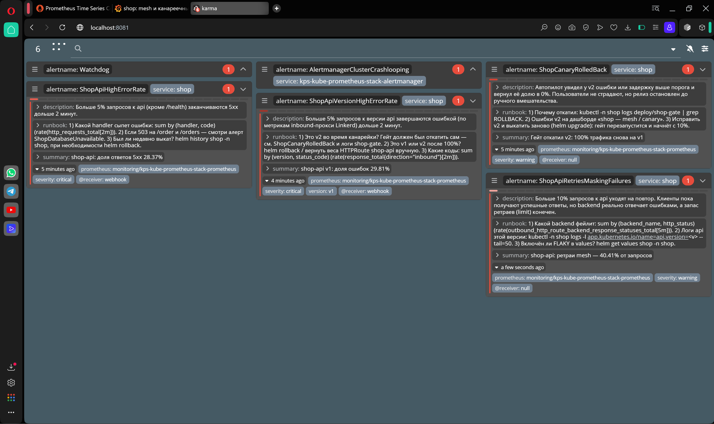

## Вывод

Что получилось:
- Linkerd встал поверх Cilium из Лабы 5, не сломав ни CNI, ни zero-trust, ни гвардрейлы Kyverno (пришлось только научить их доверять Linkerd)
- baseline до mesh: p50/p95/p99 9.6/28.9/82.7 мс, `api` 34 mCPU / 22 MiB
- mTLS подтверждён криптографически: сертификат прокси с identity по ServiceAccount (без IP), сервер видит клиента по `client_id` из его сертификата
- backend фейлит 29% запросов, клиент видит 0.84% — ровно 0.3⁴ для ретраев с limit 3; circuit breaking не участвовал
- traffic split 90/10 через `HTTPRoute`, на 1000 запросах — 89.1% / 10.9%
- автопилот сам откатил `FAIL=true` и докатил здоровую v2 до 100% за 6 минут
- цена mesh: +1.6 мс на медиане, +131% CPU и +733% памяти на всё вместе. Для системы такого размера — не оправдан
- PodMonitor на прокси, дашборд и 3 алерта в чарте, все три сработали на событиях лабы

Главные уроки лабы:
- **ретраи прячут проблемы.** Пользователю хорошо, а вот гейт и алерты, которые смотрят на клиента, становятся слепыми. Смотреть надо на то, что вернул backend
- **окно метрики помнит прошлое.** `rate()[1m]` сразу после релиза — это наполовину данные прошлого релиза. Две версии гейта ошиблись именно на этом, причём в разные стороны
- **ретраи неидемпотентного `POST` — это дубли**, если таймаут попытки меньше, чем реальное время ответа
- **вес в mesh ≠ число подов.** 2 пода v1 и 1 под v2 спокойно делят трафик 90/10
- **mesh дорог не задержкой, а всем остальным:** sidecar на каждой стороне соединения и control plane, который больше самого сервиса
- и вечное: многое ломается **молча** — `on:` в YAML, ephemeral-контейнеры мимо Kyverno, гейт, который "видит" здоровую версию по данным мёртвого пода
